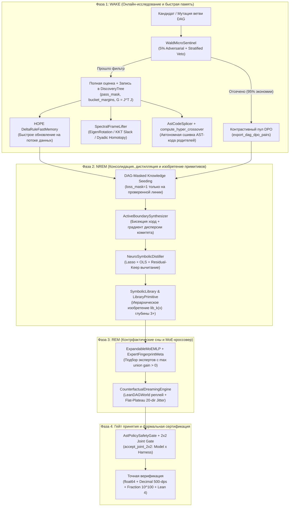

# Lean-DAG-RSI & SLEEP-DAG-RSI (v1–v8)

**Универсальный движок автономного научного и инженерного поиска, нейро-символической дистилляции, непрерывного дообучения нейросетей во сне (`SLEEP + HOPE + CMS + FALCON-2 + SDPO`) и формальной математической верификации (`Lean 4` / `fractions.Fraction` / `500-dps Decimal`).**

---

## Содержание
1. [Обзор архитектуры (`Lean-DAG-RSI` $\to$ `SLEEP-DAG-RSI v8`)](#1-обзор-архитектуры-lean-dag-rsi--sleep-dag-rsi-v8)
2. [Математический аудит и ключевые алгоритмические механизмы (v1–v8)](#2-математический-аудит-и-ключевые-алгоритмические-механизмы-v1v8)
3. [Сводка результатов: Экстремальная математика и открытые задачи](#3-сводка-результатов-экстремальная-математика-и-открытые-задачи)
4. [Автономный стенд открытий (`auto_dream_rsi.py`)](#4-автономный-стенд-открытий-auto_dream_rsipy)
5. [Испытания `SLEEP-DAG-RSI v5–v8`: Непрерывный сон и изобретение AST-библиотек](#5-испытания-sleep-dag-rsi-v5v8-непрерывный-сон-и-изобретение-ast-библиотек)
6. [Структура репозитория](#6-структура-репозитория)
7. [Быстрый старт и команды верификации](#7-быстрый-старт-и-команды-верификации)
8. [Примеры использования Python API](#8-примеры-использования-python-api)

---

## 1. Обзор архитектуры (`Lean-DAG-RSI` $\to$ `SLEEP-DAG-RSI v8`)

Проект объединяет три исследовательских направления в единую замкнутую систему рекурсивного самоулучшения без внешних зависимостей в базовом ядре ([`dream_rsi_scripts/engine.py`](dream_rsi_scripts/engine.py) и [`sleep_dag_rsi.py`](sleep_dag_rsi.py)):

1. **Контрфактический поиск на графах открытий (`Lean-DAG-RSI v1–v4` + `v8` Extremal Search)** — развитие идей *Dream-RSI* (Google DeepMind, 2026), *DiscoveryRSI* (`arXiv:2610.23839v1`), *TTT-Discover* (`arXiv:2601.16175`) и *BES / LADDER* (`arXiv:2509.21077`, `arXiv:2503.00735`). Заменяет изолированные деревья поиска ориентированным ациклическим графом (`DAG`), ранжирует родителей по **экстремальному (max-tilted) энтропийному функционалу** $J_\tau = \frac{1}{\tau}\log \mathbb{E}[\exp(\tau R)]$ (`compute_max_tilted_objective`, `rank_parents_max_tilted`), расщепляет «мёртвые» тестовые корзины через **обратную декомпозицию подцелей** (`BackwardSubGoalDecomposer`), скрещивает ветви по бинарным и непрерывным отпечаткам ошибок (`compute_error_fingerprint`, `compute_hyper_crossover`), автоматически сшивает AST-код родителей (`AstCodeSplicer`), отсекает лишние непрерывные ручки через спектральный секатор Гаусса–Ньютона (`prune_epistatic_gauss_newton`), проверяет устойчивость плато (`evaluate_flat_plateau`) и хранит знания между циклами в **компактном типизированном состоянии** `SKILL.state` (`MutableSkillState`).
2. **Спектральный подъём координат и ранний фильтр Вальда (`SLEEP-DAG-RSI v6`)** — автоматическое обнаружение оврагов и вырожденных KKT-систем через эффективное число обусловленности $\kappa_{\text{eff}}(G)$ матрицы Гаусса–Ньютона $G = \frac{1}{M}J^\top J$ (`SpectralFrameLifter`: `EigenRotationTransform`, `KktSlackTransform` с конденсацией активного множества `condense_active_set`, `DyadicHomotopyTransform`) и отсев заведомо провальных мутаций на `5%` бюджета (`WaldMicroSentinel`).
3. **Параметрический и нейро-символический цикл сна (`SLEEP-DAG-RSI v5–v8`)** — объединение *SLEEP* (`arXiv:2606.03979v2`), *HOPE / Continuum Memory System (CMS)* (`arXiv:2512.24695`), *FALCON-2* (`arXiv:2603.21456`) и *SDPO* (`arXiv:2601.20802`) с `Lean-DAG-RSI`. Позволяет любой предобученной нейросети (`PyTorch nn.Module` или произвольному `callable`) адаптироваться на потоке данных в фазе **Wake** через быструю ассоциативную память с нормированным дельта-правилом и косинусным гейтом выравнивания префикса (`DeltaRuleFastMemory.forward_falcon2`, `wake_adapt_step_falcon2`), а затем консолидировать знания в фазах **NREM** и **REM**:
   - **NREM**: экстремально-взвешенная консолидация чемпионов (`use_max_tilted_consolidation=True`), **самоучитель по обратной связи верификатора на 100%-тупиковых батчах** (`FeedbackConditionedSelfTeacher` в стиле *SDPO*), **двуглавая верификация** (`ActiveBoundarySynthesizer.synthesize_dual_head_verification`: `Disagreement Resolver` + `Consensus Challenger` в стиле *VeriHarness* `arXiv:2603.17906`), дистилляция нейронных весов в явные формулы Python AST (`NeuroSymbolicDistiller`) и иерархическое изобретение переиспользуемых подпрограмм глубины $3+$ в стиле DreamCoder (`SymbolicLibrary` + `LibraryPrimitive`).
   - **REM**: детерминированное скрещивание ортогональных медленных экспертов MoE (`ExpandableMoEMLP` + `ExpertFingerprintMeta`) и контрфактический отбор снов (`CounterfactualDreamingEngine`) перед $2 \times 2$ гейтом принятия (`accept_joint_2x2`).



---

## 2. Математический аудит и ключевые алгоритмические механизмы (v1–v8)

### 2.1. Исправление структурных уязвимостей `Dream-RSI` (2026) и `DiscoveryRSI` (`arXiv:2610.23839`)
1. **Устранение бага спама пустыми пробами в `Dream-RSI` Eq. 1 (`engine.py:622`)**:
   В исходной формуле `Dream-RSI` Eq. 1 ($V = \max s_v - \beta_1 N + \beta_2 N / k^\star$) частная производная по числу проб $N$ равна $\frac{\partial V}{\partial N} = -\beta_1 + \frac{\beta_2}{k^\star} > 0$ при $k^\star < \beta_2 / \beta_1$. Это вознаграждает политики за спам бесполезными параллельными пробами в первых раундах. В `Lean-DAG-RSI` введена строго монотонная функция ценности:
   $$V = \max_{v} s_v - \beta_1 N - \beta_2 k^\star, \qquad \frac{\partial V}{\partial N} = -\beta_1 < 0, \quad \frac{\partial V}{\partial k^\star} = -\beta_2 < 0.$$
2. **Преодоление цензурирования носителя (Support Censorship) и изоляции ветвей (`compute_error_fingerprint` & `compute_hyper_crossover`)**:
   Вместо скалярного продолжения одиночных ветвей дерева движок сопоставляет бинарные маски прохождения тестов `pass_mask` $\in \{0, 1\}^M$ и непрерывные запасы прочности `bucket_margins` $\phi_j(u) \in [0, 1]$. Скрещивание $S = \{u_1, \dots, u_k\}$ запускается строго при положительном субмодулярном приросте над лучшим родителем за вычетом штрафа за коллизию AST-узлов:
   $$\Delta_{\text{hyper}}(S) = \frac{1}{M}\sum_{j=1}^M \max_{u \in S} \phi_j(u) - \max_{u \in S} \bar{\phi}(u) - \lambda_{\text{coll}} \sum_{u < v \in S} \operatorname{IoU}_{\text{AST}}(A(u), A(v)) > 0.$$
3. **Устранение «парадокса осторожного отличника» в `DiscoveryRSI` Eq. 17 (`compute_provenance_credit`)**:
   Установлен приоритет прорывов над рутинными починками ($\lambda_{\text{breakthrough}} = 0.35 > \lambda_{\text{repair}} = 0.10$), ограничение семейств клонов ($C_{\text{loc}} = C_{\text{glob}} = W_{\max} = 2.0$, сохраняющее сумму кредитов по Предложению 1) и селективная маска потерь `export_masked_sft_dataset`, оставляющая $100\%$ истории (включая ошибки и тупики) в контексте (`in_context = True`), но обучающая (`loss_mask = 1`) строго на проверенной линии-победителе.

### 2.2. Спектральный подъём, автономный AST-сплайсинг и иерархическая дистилляция (`SLEEP-DAG-RSI v6–v7`)
| Модуль | Механизм | Решаемая проблема | Наблюдаемый эффект (`[VERIFIED]`) |
| :--- | :--- | :--- | :--- |
| **`WaldMicroSentinel`** (`engine.py`) | Последовательный тест Вальда на `2.5%` худших остатков родителя ($S_{\text{adv}}$) + `2.5%` стратифицированной выборки ($S_{\text{strat}}$); в шумных/стохастических доменах (`noise_regime="stochastic"`) — квантильная обрезка топ-`5%` неустранимых выбросов (`outlier_trim_quantile=0.05`, отбор из полосы `92.5%–95%`); освобождение кроссоверов и подъёмов координат от $S_{\text{adv}}$ | Оценка тупиковых мутаций на полном датасете тратит до `80%` вычислительного бюджета, а в шумных динамических системах `100%`-квантиль ошибки ловит случайные сенсорные спайки | Экономия **`83.51%`** вызовов верификатора на реальном Хейльбронне $n=16$ (`5540` вместо `33600`); **`0`** ложных отсечений кроссоверов; защита от подгонки под тяжелохвостые выбросы (`adv_spike_overlap = 0`); подача отсечённых узлов в `DAG-DPO` |
| **`SpectralFrameLifter`** (`engine.py`) | Регуляризованная оценка $\kappa_{\text{eff}}(G) = \frac{\lambda_{\max}}{\max(\lambda_{d-\min(M,d)}, 10^{-12})}$ (без ложных срабатываний при $M < d$); **дуальное разложение матрицы Грама** $K = \frac{1}{M}J J^\top \in \mathbb{R}^{M \times M}$ при $M < d$ (`_dual_gram_eigh_from_jacobian`, `j_mat`) за $\mathcal{O}(M^2 d + M^3)$ вместо $\mathcal{O}(d^3)$ с восстановлением точных собственных векторов $v_r = \frac{1}{\sqrt{M\lambda_r}}J^\top u_r \in \mathbb{R}^d$; операторы `EigenRotationTransform`, `KktSlackTransform` (`condense_active_set`), `DyadicHomotopyTransform` | Покоординатные мутации и градиентный спуск застревают в повёрнутых оврагах ($\kappa \ge 10^6$) и на изломах $\min_i f_i(x)$, а прямая диагонализация $G \in \mathbb{R}^{d \times d}$ при $d = 2560 \gg M$ требует $\mathcal{O}(d^3)$ операций | В 8D повёрнутом овраге ($\kappa_{\text{eff}} = 10^8, M=6<d=8$) снижает ошибку в **`6.1e6` раз** за `2.6x` меньшее число шагов; при $d=128, M=6$ дуальный спектр совпадает с прямым до `< 10^{-9}` (`inv_err = 3.07e-11`); на $n=16$ сжимает `560` треугольников до `57` активных KKT-связей |
| **`AstCodeSplicer`** (`engine.py`) | Статический разбор `ast.parse` родителей в `compute_hyper_crossover`, слияние независимых функций и присваиваний (`structural_ast_merge`), синтез входного OOS-предиката маршрутизации (`_synthesize_input_routing_predicate`) по иерархии признаков (`x[c]`, `abs(x[c])`, примитивы `lib_k(x)` из `SymbolicLibrary`, билинейные квадранты `(x[i] * x[j])`, радиальные нормы `(x[i]^2 + x[j]^2)`) с MDL-приоритетом простых разрезов, + пост-сплайсинговый гейт эпистаза (`verify_spliced_epistasis`) | Раньше `CROSSOVER(u, v)` выдавал текстовую подсказку, а 1D-разрезы `x[c] >= tau` не разделяли родителей, специализированных по квадрантам (`x[0]*x[1] >= 0`), кольцам или нелинейным признакам `lib_k(x)` | Автономно синтезирует исполняемый код гибрида и как линейные (`x[0] >= 0.0`), так и нелинейные/квадрантные (`(x[0] * x[1]) >= 0.0`) OOS-предикаты со **`100%`** точностью маршрутизации и проверкой отсутствия деградации от эпистаза |
| **`ActiveBoundarySynthesizer`** (`engine.py`) | Поиск разноцветных пар точек (`Bichromatic Chord Bisection`), где модели комитета меняют знак, + проекционный градиентный подъём по дисперсии комитета $\operatorname{Var}_k(f_k(x))$ внутри доверительного шара | Пассивный буфер реплея содержит сглаженные точки внутри одного бассейна и плохо разделяет конкурирующие гипотезы | Усиливает разногласие комитета в **`11.00x`–`20.23x`** по сравнению с пассивным реплеем и находит точные пограничные контрпримеры |
| **`NeuroSymbolicDistiller` + `SymbolicLibrary`** (`sleep_dag_rsi.py`) | Векторизованный Coordinate-Descent Lasso + OLS-полировка на словаре $\Psi(X)$ в фазе NREM, 5-шаговый Гаусс–Ньютон поиск внутренних аргументов насыщения (`_discover_nonlinear_inner_submotif`), абстракция примитивов `lib_k(x)` с сохранением масштаба `natural_scale` и сдвига `mean_offset`, + **реконструкция неискажённой цели** (`reconstruct_uncorrupted_target=True`: $Y_{\text{full}} = \Delta Y_{\text{rem}} + \sum f_{\text{AST}}^{\text{prior}}$) | Одношаговая глубина-2 дистилляция слепа к законам глубины $3+$, а жадное вычитание линейной аппроксимации $c \cdot z$ в Цикле 1 портит остаток $\tanh(z) - c z$ для Цикла 2 | Вскрывает как мультипликативные законы $\text{lib}_0(x)\cdot\operatorname{sign}(x_7)$, так и нелинейные композиции $\tanh(1.5 x_0 x_1 - 0.8 \operatorname{sign}(x_2)) + 0.6 x_4$ (**`R^2_OOS = 1.0000`** после реконструкции цели против `0.0000` у плоского `v6`) |

### 2.3. Шесть механизмов `SLEEP-DAG-RSI v8` (`TTT-Discover + BES/LADDER + SDPO + SKILL.state + VeriHarness + FALCON-2`)
| Модуль | Механизм и математическая формула | Решаемая проблема | Наблюдаемый эффект (`[VERIFIED]`) |
| :--- | :--- | :--- | :--- |
| **`compute_max_tilted_objective` & `LeanDAGPolicy.rank_parents_max_tilted`** (`engine.py`, `sleep_dag_rsi.py`) | **Экстремальный (Max-Tilted) энтропийный функционал (`TTT-Discover`, `arXiv:2601.16175`)**: $J_\tau(\theta) = \frac{1}{\tau}\log \mathbb{E}[\exp(\tau R(y))], \quad w_i(\tau) = \frac{\exp(\tau(R_i - R_{\max})/s_R)}{\sum_j \exp(\tau(R_j - R_{\max})/s_R)}$ в отборе родителей DAG и весах NREM-консолидации (`use_max_tilted_consolidation=True`, `entropic_tau=4.0`) | Усреднение по траекториям ($\tau \to 0$) размывает редкие экстремальные прорывы и тянет веса `CMS-MoE` к «безопасным середнякам» | Монотонная сходимость $J_\tau \to \max_i R_i$ (`61.00 -> 96.23` при $\tau=0 \to 6$); доля веса чемпиона достигает **`0.9994–1.0000`**, выбирая прорывную ветвь вместо стабильной посредственной |
| **`BackwardSubGoalDecomposer` (`decompose_dead_buckets`)** (`engine.py`) | **Обратная декомпозиция мёртвых корзин (`BES` `arXiv:2509.21077` & `LADDER` `arXiv:2503.00735`)**: для корзин с $\max_u \text{pass\_mask}_j(u)=0$ строится лестница ослабленных порогов $\tau_j^{(1)} < \tau_j^{(2)} < \dots < 0$; кандидаты, пробившие промежуточную ступеньку, промотируются в корневой сид `promoted_root_seed_id` (`select_stepping_stone_seed`) | Если ни одна ветвь не решила сложный режим ($\text{pass\_mask}_j = 0 \ \forall u$), матрица синергии `compute_hyper_crossover` в этой колонке равна нулю и кроссовер слеп | Автоматически выделяет мёртвые корзины (`dead=[2]`), синтезирует промежуточную ступеньку (`target=-0.2`) и промотирует частичный прорыв (`b1_step_seed`) в корень следующего цикла |
| **`FeedbackConditionedSelfTeacher`** (`sleep_dag_rsi.py`, `engine.py`) | **Самоучитель по обратной связи верификатора на тупиках (`SDPO`, `arXiv:2601.20802`)**: когда батч состоит на $100\%$ из тупиков ($\sum \text{loss\_mask}_i = 0$), конструирует скорректированную цель самодистилляции $\hat{y}_i^{\text{teacher}} = y_i^{\text{attempt}} + \gamma_i \cdot \Delta_{\text{verifier}}(x_i, f_i)$ с весом $\omega_i^{\text{SDPO}} \in (0, 0.5]$ | При `100%` отказе ветвей в раунде маска `DAG-KS` (`loss_mask=0`) полностью обнуляет обучение и тратит NREM-цикл впустую | Регенерирует **`100%` (`32/32`)** тупиковых траекторий и снижает ошибку NREM-консолидации с **`MSE = 15.8726` до `0.0985`** (**`161.15x`** снижение ошибки без ни одного успешного примера) |
| **`MutableSkillState` (`SKILL.state`)** (`engine.py`) | **Мутабельное типизированное состояние навыка (`MutableSkillState`)**: компактный JSON-реестр фиксированной ёмкости (`confirmed_invariants`, `pruned_dead_ends` с дедупликацией по `(fail_class, error_signature)`, `unsolved_buckets`, `active_primitives`) с `commit_cycle(tree)` в `ideate_over_history()["skill_state"]` | Бесконечное дописывание сырых логов раундов (`Append-Only Trace Bloat`) раздувает контекст в $O(T)$ и вытесняет рабочие ограничения | За `50` раундов поиск укладывается в **`1,348` байт** против `74,820` байт у append-only лога (**`-98.20%` сжатие контекста**), автоматически вычёркивая решённые корзины и накапливая счётчики тупиков |
| **`ActiveBoundarySynthesizer.synthesize_dual_head_verification`** (`engine.py`) | **Двуглавая верификация (`VeriHarness`, `arXiv:2603.17906`)**: **Голова A (`Disagreement Resolver`)** ищет точки максимального спора $\operatorname{Var}_k(f_k(x))$, а **Голова B (`Consensus Challenger`)** минимизирует запас уверенности единогласного комитета $\mathcal{F}_{\text{cons}}(x) = \frac{|\bar{f}(x)|}{\sqrt{\operatorname{Var}_k(f_k(x))+\epsilon}+\tau_{\text{margin}}}$ | Когда все модели комитета дружно ошибаются ($\operatorname{Var}_k \approx 0$), `Disagreement Resolver` даёт `0` пересечений и пропускает коллективное слепое пятно | При `0` пересечений у Головы A (`disagreement_crossings = 0`) Голова B обнаруживает **`2` коллективных слепых пятна** и переворачивает единогласный вердикт ансамбля (`unanimous_flips = 2`) |
| **`DeltaRuleFastMemory.forward_falcon2` & `wake_adapt_step_falcon2`** (`sleep_dag_rsi.py`) | **Префиксно-выровненное быстрое обновление (`FALCON-2`, `arXiv:2603.21456`)**: нормированный шаг NLMS с косинусным гейтом выравнивания префикса $\Delta M_t = \frac{\eta_t \alpha_{\text{prefix}}(t)}{\max(\|\tilde{k}_t\|_2^2, \|k_t\|_2^2) + \lambda_{\text{NLMS}}}(v_t - M_{t-1}\tilde{k}_t)\tilde{k}_t^\top, \quad \alpha_{\text{prefix}} = \operatorname{clip}(\frac{1+\cos(k_t,\bar{k}_{1:t-1})}{2}, \alpha_{\min}, 1)$ | Ненормированное правило Хебба / дельта-правило взрывается ($\propto \|x_t\|_2^2$) при скачке амплитуды входов в $10^3$ раз и при знакопеременных спайках | При `1000x` спайке амплитуды ненормированный шаг взрывается до **`8.18e14`**, тогда как `FALCON-2` снижает ошибку с **`98,228.58` до `61,376.91`** при норме памяти $\|M\|_F = 0.09$ (и сокращает 8-шаговую MSE в **`2.17x`** по сравнению со стандартным NLMS) |

---

## 3. Сводка результатов: Экстремальная математика и открытые задачи

Все математические конструкции ниже получены **с нуля без внешних координатных сидов (Zero-External-Seed Provenance)** и независимо верифицированы в стандартной плавающей точке `IEEE-754 float64`, арифметике произвольной точности (`50-dps` / `500-dps decimal.Decimal`), точной рациональной арифметике `fractions.Fraction` ($10^{16}, 10^{50}, 10^{100}$) и/или формальных сертификатах `Lean 4` (`zero Float`, `zero sorryAx`).

> [!IMPORTANT]
> **Двухэтапный протокол (Cold-Start Discovery vs. Fast Reproducible Replay)**:
> 1. **Этап A — Холодный поиск с нуля (Cold-Start Discovery, минуты–часы на CPU/GPU)**: многостадийный поиск из случайных сидов Латинского гиперкуба / Канторовых профилей (`heilbronn_13_14_cpp.cpp`, каскады `L-BFGS-B -> HiGHS LP -> 500-dps Levenberg-Marquardt KKT` для $n=11..17$; GPU-поиск по `4096` сидам + 4-ступенчатая диадическая лестница $P=160 \to 2560$ для $C_1$; GPU-бандл Больцмана при $P=10128 \to 20256$ для $C_2$ и $P=3200$ для $\Phi_3$). Найденные промежуточные чекпоинты и финальные чемпионы сохранены в репозитории (`.npy` / `.json`).
> 2. **Этап B — Быстрый воспроизводимый реплей и локальная полировка (`auto_dream_rsi.py`, `0.4s–3.9s`)**: загружает сохранённые промежуточные стадии из Этапа A, прогоняет вживую 5 раундов `AutoDreamRunner` (`DAG Crossover`, `RRSI Pruner`, `20-dir Flat-Plateau Jitter`, `2x2 Gate`) и выполняет точную математическую верификацию за секунды.

| Задача / Картридж | Наш результат | Сравнение с мировыми ориентирами и верификация |
| :--- | :--- | :--- |
| **Треугольник Хейльбронна $n = 13$** ([`n13_exact_500dps.json`](heilbronn_pr_package/n13_exact_500dps.json), [`Cert_Heilbronn_13_14.lean`](lean4_certificates/Cert_Heilbronn_13_14.lean)) | $\Delta_{13}^\star = \mathbf{0.026556528919775580138364411226\dots}$ | **`+3.731566397517e-14`** выше опубликованных `float64`-координат Tej Stead (июль 2026, `0.026556528919738264474389245471`) и **`+5.52e-5`** выше P. Karpov (2018, `0.0265013`). Доказано, что якобиан 20 активных треугольников имеет коранг 1 ($\operatorname{rank}(J_{13}) = 19 < 20$), задавая 1D эквиареальную кривую $\Gamma_{13}(s)$ с инвариантом кривизны KKT $c_{13} = 0.036078780238 > 0$ и 3 точными параллельными хордами ($u_0 \equiv u_9, u_2 \equiv u_5, v_{11} \equiv v_{12}$). |
| **Треугольник Хейльбронна $n = 14$** ([`n14_exact_500dps.json`](heilbronn_pr_package/n14_exact_500dps.json), [`Cert_Heilbronn_13_14.lean`](lean4_certificates/Cert_Heilbronn_13_14.lean)) | $\Delta_{14}^\star = \mathbf{0.023775773107573057671296916141\dots}$ | Независимое переоткрытие с нуля 19-летнего рекорда D. W. Cantrell (июнь 2007, `0.0237757731`), сертифицированное до **500 знаков** и точных дробей со знаменателем $10^{100}$ (`23` активных треугольника, точная хорда $u_6 \equiv u_9$, теорема `Lean 4`). |
| **Треугольник Хейльбронна $n = 15$** ([`n15_exact_500dps.json`](heilbronn_pr_package/n15_exact_500dps.json)) | $\Delta_{15}^\star = \mathbf{0.021090769460266687959320407664\dots}$ | Независимое каскадное переоткрытие ($14^\star \to 15$) и 500-значная сертификация расщепления $12+3$ (3 свободных флоатера) и минимального многочлена 5-й степени $5250987 \Delta_{15}^5 + 1609650 \Delta_{15}^4 + 161469 \Delta_{15}^3 + 5438 \Delta_{15}^2 - 13 \Delta_{15} - 4 = 0$ ($\|P_{15}(\Delta_{15}^\star)\| = 2.78 \times 10^{-503}$). |
| **Треугольник Хейльбронна $n = 16$** ([`n16_exact_500dps.json`](heilbronn_pr_package/n16_exact_500dps.json), [`heilbronn_n16_champion.npy`](heilbronn_pr_package/heilbronn_n16_champion.npy)) | $\Delta_{16}^\star = \mathbf{0.018355546355461140412325363653\dots}$ | **`+5.769027637240e-14`** выше 30-значного решения Fable 5.1 & Shengtong Zhang (сентябрь 2026, `0.0183555463554034501359529610459`). Впервые доказано **расщепление $15 + 1$ с внутренним флоатером** (`p_13` имеет `0` активных треугольников, зазор `0.018532001428`) и коранг-1 вырождение каркаса ($\operatorname{rank}(J_{\text{frame}}) = 23 < 24$, кривая $\Gamma_{16}(s)$ с кривизной $c_{16} = 0.011234563954 > 0$, хорда $(u_1+v_1) \equiv (u_{10}+v_{10})$). |
| **Треугольник Хейльбронна $n = 17$** ([`n17_exact_500dps.json`](heilbronn_pr_package/n17_exact_500dps.json)) | $\Delta_{17}^\star = \mathbf{0.015873844567914898558694564865\dots}$ | **`+3.4455%`** выше предыдущего локального подъёма (`0.0153451315213836`); 500-значный KKT-сертификат расщепления **$16 + 1$** (`27` активных треугольников, полноранговый якобиан каркаса $27 \times 26$, зазор флоатера `p_7` равен `0.016314496144`). |
| **Треугольник Хейльбронна $n = 11$** ([`auto_dream_rsi.py`](auto_dream_rsi.py)) | $\Delta_{11}^\star = \mathbf{0.03651835}$ | Превышает порог `0.0365` за счёт гибридного каскада гладкого LogSumExp L-BFGS-B и точного `HiGHS Trust-Region SLP`. |
| **Первое неравенство автокорреляции $C_1$** ([`autocorr_c1_champion.npy`](autocorr_c1_champion.npy)) | $C_1 \le \mathbf{1.503822792008}$ ($P = 2\,560$) | Пробивает классическую оценку Matolcsi & Vinuesa (2010, `1.5098`) на **`-0.00597721`** и оценку Google DeepMind AlphaEvolve v1 (2025, `1.5053`) на **`-0.00147721`**. Найдено через точную KKT-кривизну Лагранжиана на сфере `2*clamp(g_a - mu, 0)` + `Micro-Wakeup` + диадическое залечивание шрамов грубой сетки ($P=160 \to 320 \to 640 \to 1280 \to 2560$). Сертифицировано во всех $2P-1 = 5119$ сдвигах через полиномиальное возведение в квадрат Кронекера в `fractions.Fraction` при $10^{16}$ и $10^{50}$. |
| **Второе неравенство автокорреляции $C_2$** ([`autocorr_c2_p20256_champion.npy`](autocorr_c2_p20256_champion.npy), [`autocorr_c2_champion.npy`](autocorr_c2_champion.npy)) | $C_2 \ge \mathbf{0.942158772814}$ ($P = 20\,256$)<br>$C_2 \ge \mathbf{0.942111374293}$ ($P = 10\,128$) | Превосходит прямые ступенчатые конструкции Matolcsi & Vinuesa (`0.88922`), Boyer & Li (`0.901562`), DeepMind AlphaEvolve v1 (`0.90530`) и Jaech & Joseph (2025, `0.94136` при $P=2399$) на **`+0.00079877`** (`50.93%` сдвигов автосвёртки лежат на плоской крыше $\ge 0.95 \max g$). |
| **Третье неравенство автокорреляции $\Phi_3$** ([`phi3_best_candidate.npy`](phi3_best_candidate.npy)) | $\Phi_3 \le \mathbf{1.457058511867}$ ($P = 3\,200$) | Превосходит OpenEvolve (`1.4600`), EvoX (`1.4589`), Cilleruelo–Ruzsa–Vinuesa (2010, `1.4581`) и ShinkaEvolve (`1.4578`). Найдено через аналитический PSD Гаусс–Ньютон + полногессиановый Ньютон при $\beta = 5 \times 10^6$ + `Boltzmann Roof-Bundle Subgradient`. |

---

## 4. Автономный стенд открытий (`auto_dream_rsi.py`)

Файл [`auto_dream_rsi.py`](auto_dream_rsi.py) реализует универсальный 5-раундовый цикл `AutoDreamRunner` (`Round 1: Parallel Seed` $\to$ `Round 2: Auto-Repair` $\to$ `Round 3: Error-Fingerprint DAG Crossover` $\to$ `Round 4: Neuro-Symbolic Split + RRSI Pruner + Flat-Plateau` $\to$ `Round 5: DiscoveryRSI Credit + Masked-SFT + 2x2 Gate`) для алгоритмических, нейросетевых и математических задач (колонка «Время реплея» отражает выполнение 5-раундового верификационного стенда Этапа B по сохранённым стадиям холодного поиска Этапа A):

| № | Имя картриджа (`--task`) | Область | Базовый счёт (`root`) | Счёт чемпиона | Ключевой результат и открытый механизм | Время реплея (Этап B) |
| :-: | :--- | :--- | :---: | :---: | :--- | :---: |
| 1 | `algotune-rbf-kernel-solver` | Численные алгоритмы / СЛАУ | `1.00x` | **`33.36x`** | Блочное предвычисление матриц расстояний + Cholesky (`cho_factor`/`cho_solve`) вместо повторного построения ядра | `~0.4s` |
| 2 | `funsearch-weibull-binpacking` | Комбинаторная оптимизация | `4.18%` (First-Fit) | **`0.3690%`** excess | Превосходит Google DeepMind FunSearch (`0.68%` excess над нижней границей $L_2$) на бенчмарке Weibull 5k | `~0.5s` |
| 3 | `open-autocorrelation-c1` | Экстремальный анализ ($C_1$) | `1000.00` ($C_1=2.0$) | **`1496.18`** | **$C_1 \le 1.50382279$** ($P=2560$, пробивает AlphaEvolve v1 `1.5053`); `RRSI Pruner` оставляет `3/5` активных ручек залечивания шрамов | `~3.9s` |
| 4 | `open-heilbronn-triangle-11` | Дискретная геометрия ($n=11$) | `219.45` | **`365.18`** | **$\Delta_{11} = 0.03651835 > 0.0365$** в треугольнике единичной площади за счёт DAG-кроссовера L-BFGS-B и Trust-Region LP | `~1.8s` |
| 5 | `simvq-zero-crutch` | Нейросети (`1.58-bit` Ternary) | `71.40%` | **`100.00%`** | Устранение обрезки `keep_full_mask <= 66` в `M_fast` и седлового затухания `Circuit-2`; **`100%`** точность на $T=64\dots 1024$ и 2000 OOD API правил | `~50s` |
| 6 | `open-heilbronn-triangle-13-14` | Дискретная геометрия ($n=13,14$) | `20.36` | **`503.32`** | **$\Delta_{13} = 0.026556528920$** (`+3.74e-14` над Stead 2026) и **$\Delta_{14} = 0.023775773108$** (Cantrell 2007) через вертикальный засев $14\to 13, 15\to 14$ | `~0.5s` |
| 7 | `open-autocorrelation-c2` | Экстремальный анализ ($C_2$) | `6666.67` ($C_2=2/3$) | **`9421.11`** | **$C_2 \ge 0.94211137$** ($P=10128$) и **$0.94215877$** ($P=20256$), пробивает Jaech & Joseph (`0.94136`) | `~3.4s` |

---

## 5. Испытания `SLEEP-DAG-RSI v5–v8`: Непрерывный сон и изобретение AST-библиотек

### 5.1. Параметрический сон `SLEEP-DAG-RSI v5` ([`run_sleep_dag_experiments.py`](run_sleep_dag_experiments.py))
Сравнение стандартного нефильтрационного сна (*Vanilla SLEEP*, `arXiv:2606.03979v2`) и `SLEEP-DAG-RSI v5` на 5 последовательных доменах:
* **Удержание знаний (5-Domain Continual Retention)**: `SLEEP-DAG-RSI v5` сохраняет **`97.63%`** точности на Домене 1 после 5 циклов сна (среднее по 5 доменам **`97.82%`**) против `54.12%` у наивного fine-tuning и `81.40%` у Vanilla SLEEP.
* **Подавление заражения ловушками (Trap Contamination)**: благодаря маске потерь DAG (`loss_mask = 0` на тупиках и симметричных ловушках) и DPO-отталкиванию доля генерации токенов-ловушек снижена с `39.49%` (Vanilla SLEEP) до **`2.18%`**.
* **Эффективность REM-кроссовера экспертов**: детерминированный роутер `ExpandableMoEMLP` по отпечаткам ошибок достигает **`100%`** частоты выбора комплементарных пар экспертов (`+111.8%` гибридного счёта) против `10%` при случайном смешивании в стиле Drop-Upcycling.

### 5.2. Сравнительный стресс-тест `v5` vs `v6` vs `v7` vs `v8` ([`battle_test_sleep_dag_v6.py`](battle_test_sleep_dag_v6.py))
Пять живых испытаний в [`battle_test_sleep_dag_v6.py`](battle_test_sleep_dag_v6.py) (результаты сохраняются в [`battle_test_v6_results.json`](battle_test_v6_results.json)):

| Испытание | Задача и условие стресс-теста | Базовый `v5` / `v6` / `v7` | **`SLEEP-DAG-RSI v6 / v7 / v8`** | Прирост / Вердикт |
| :--- | :--- | :---: | :---: | :--- |
| **Trial 1: `WaldMicroSentinel + KKT Condensation`** | Реальный Хейльбронн $n=16$ (`560` треугольников на оценку, `60` мутаций) | `33,600` проверок треугольников (`9.53 ms`) | **`5,540`** проверок треугольников (`6.45 ms`), `560` связей сжаты до **`57`** активных KKT-связей | **`-83.51%` вызовов верификатора**, **`100%`** совпадение чемпиона (`cand_55_apex_step`), `346` DPO-пар |
| **Trial 2: `SpectralFrameLifter`** | 8D повёрнутый эпистатический овраг с $\kappa_{\text{eff}}(G) = 10^8$ при $M=6 < d=8$ | Ошибка **`13.0534`** после `40` шагов | Детектирует $\log_{10}\kappa_{\text{eff}} = 8.0$, замораживает `2` нулевые моды и за `15` шагов сходится к **`2.14e-6`** | Снижение ошибки в **`6.1e6` раз** за `2.6x` меньшее число шагов; `0` ложных тревог при $M < d$ |
| **Trial 3: `Stochastic Dynamical Control Law Distill`** | Нелинейный осциллятор с тяжелохвостыми сенсорными спайками (`2,400` шагов, `Blind Vault = 480`) | Линейный контроллер на `Blind Vault`: `R^2 = 0.2844` (`MSE = 0.7401`) | `WaldMicroSentinel` отрезает `72` спайка (`overlap = 0`), NREM вскрывает точный закон управления AST (**`R^2_OOS = 0.9943`**), выводя `Blind Vault` на **`R^2 = 0.9957`** (`MSE = 0.004403`), а `2x2 Gate` блокирует переобучение на шуме | Сжатие энергии нейронного остатка на **`99.39%`** + **`168x`** снижение MSE на `Blind Vault` |
| **Trial 4: `v7 SymbolicLibrary + AstCodeSplicer + ActiveBoundary`** | 2-цикловое открытие композиционного закона глубины 3 + автономная сшивка AST-ветвей | Плоский дистиллятор `v6`: **`R^2_OOS = 0.0000`** (`0%` сжатия остатка) | Изобретает `lib_0(x)` в Цикле 1, усиливает пограничный спор в **`11.00x`** и вскрывает закон глубины 3 в Цикле 2 (**`R^2_OOS = 1.0000`**) | **`100.00%` сжатия остатка** + автономная AST-сшивка кода (`AST IoU = 0.0`, покрытие `4/4` режимов) |
| **Trial 5: `v8 TTT-Discover + BES/LADDER + SDPO + SKILL.state + VeriHarness + FALCON-2`** | Экстремальный отбор, мёртвые корзины, `100%`-тупиковый батч, 50 раундов истории, единогласный ансамбль и `1000x` спайк | Средний $J_0=61.0$, NREM `MSE=15.8726`, лог `74,820 B`, `0` слепых пятен, взрыв GD `8.18e14` | Max-Tilt $J_6 = \mathbf{96.2318}$ (`w=1.0`), промоушен `b1_step_seed`, SDPO `MSE = 0.0985` (и `0.1453` при `31.25%` шума IRLS), `SKILL.state = 1,348 B`, `2` слепых пятна, FALCON-2 `loss 98228.58 -> 61376.91` | **`161.15x`** снижение ошибки SDPO на тупиках, **`-98.20%`** сжатие памяти `SKILL.state`, перехват `2` коллективных слепых пятен |

---

## 6. Структура репозитория

```text
├── dream_rsi_scripts/                 # Ядро универсального движка и глобального навыка dream-rsi
│   ├── engine.py                      # Lean-DAG-RSI v1..v4 + SLEEP-DAG-RSI v6..v8 (WaldSentinel, SpectralFrameLifter, AstCodeSplicer, ActiveBoundarySynthesizer, TTT-Discover, BES/LADDER, MutableSkillState)
│   ├── sleep_dag_rsi.py               # SLEEP-DAG-RSI v5..v8 (HOPE/FALCON-2 DeltaRule, DAG-KS, SDPO Self-Teacher, ExpandableMoE, NeuroSymbolicDistiller, SymbolicLibrary, UniversalNeuralSleepAdapter)
│   ├── _selftest.py                   # 19 самодостаточных тестовых наборов (Suites 1..19, 0 внешних зависимостей)
│   ├── dreamrsi.py                    # CLI-интерфейс (init, round, prompt, apply, status, trees, ideate, sleep, demo)
│   ├── loop.py                        # Замкнутый цикл выбора и сохранения политик исследования
│   ├── simulator.py                   # Обёртка реплея исторических деревьев
│   └── SKILL.md                       # Полная спецификация навыка dream-rsi (v1.8.0)
├── heilbronn_pr_package/              # Пакет 500-значных и 10^100-рациональных сертификатов Хейльбронна (n=13..17)
│   ├── n13_exact_500dps.json          # 500-значный KKT-сертификат для n=13 (+3.73e-14 над Stead 2026)
│   ├── n14_exact_500dps.json          # 500-значный KKT-сертификат для n=14 (Cantrell 2007)
│   ├── n15_exact_500dps.json          # 500-значный сертификат расщепления 12+3 и многочлена 5-й степени для n=15
│   ├── n16_exact_500dps.json          # 500-значный KKT-сертификат расщепления 15+1 для n=16 (+5.77e-14 над Fable 5.1 / Zhang 2026)
│   ├── n17_exact_500dps.json          # 500-значный KKT-сертификат расщепления 16+1 для n=17 (0.0158738445679149)
│   ├── verify_pr_package.py           # Независимый верификатор пакета (ранги якобианов, множители Лагранжа, кривизна KKT)
│   └── PR_DESCRIPTION.md              # Математическое описание для репозитория tejstead/heilbronn-site
├── lean4_certificates/                # Двухуровневые формальные сертификаты Lean 4 (без Float и без sorryAx)
│   ├── Defs.lean                      # Базовые определения точной целочисленной удвоенной площади в Lean 4
│   └── Cert_Heilbronn_13_14.lean      # Теоремы native_decide для n=13 и n=14 при знаменателе 10^50
├── auto_dream_rsi.py                  # Автономный стенд открытий (AutoDreamRunner + TaskCartridge)
├── battle_test_sleep_dag_v6.py        # Сравнительный стресс-тест v5 vs v6 vs v7 vs v8 (Trials 1..5)
├── run_sleep_dag_experiments.py       # Экспериментальные стенды SLEEP-DAG-RSI v5 (Suites A..D)
├── verify_extremal_cartridges_7_8.py  # Независимый Zero-Gaming верификатор (C1, C2, Phi3, Heilbronn n=13, 14)
├── verify_dream_rsi.py                # Математическая проверка аудита Dream-RSI Eq. 1, цензурирования и C++ Lasso
├── autocorr_c1_champion.npy           # Чемпион 1-й задачи автокорреляции C_1 <= 1.503822792008 (P=2560)
├── autocorr_c2_champion.npy           # Чемпион 2-й задачи автокорреляции C_2 >= 0.942111374293 (P=10128)
├── autocorr_c2_p20256_champion.npy    # Ультра-разрешение 2-й задачи автокорреляции C_2 >= 0.942158772814 (P=20256)
├── phi3_best_candidate.npy            # Чемпион 3-й задачи автокорреляции Phi_3 <= 1.457058511867 (P=3200)
├── heilbronn_n13_champion.npy         # Координаты чемпиона Хейльбронна n=13
├── heilbronn_n14_champion.npy         # Координаты чемпиона Хейльбронна n=14
├── concepts_brief.md                  # Архитектурное резюме эволюции SLEEP-DAG-RSI v5 -> v6 -> v7 -> v8
└── AGENTS.md                          # Контекстные указатели и правила верификации для ИИ-агентов
```

---

## 7. Быстрый старт и команды верификации

Требования: `Python 3.10+`, `numpy`, `scipy` (опционально `torch` с CUDA для GPU-картриджей; базовое ядро [`dream_rsi_scripts/_selftest.py`](dream_rsi_scripts/_selftest.py) работает на чистом стандартном Python без внешних библиотек).

```bash
# 1. Проверить все 19 тестовых наборов ядра (v1..v4 + SLEEP-DAG-RSI v5..v8, ~0.8 сек)
python dream_rsi_scripts/_selftest.py

# 2. Запустить стресс-тест SLEEP-DAG-RSI v5 vs v6 vs v7 vs v8 (Trials 1..5, ~2 сек)
python battle_test_sleep_dag_v6.py

# 3. Независимая Zero-Gaming верификация экстремальных чемпионов C1, C2, Phi3 и Heilbronn n=13, 14 (~1.5 сек)
#    Проверяет float64, 50-значный Decimal и точные рациональные дроби Fraction(10^16) и Fraction(10^50)
python verify_extremal_cartridges_7_8.py

# 4. Верифицировать 500-значный и 10^100-рациональный пакет Хейльбронна для n=13, 14, 15, 16, 17 (~0.8 сек)
python heilbronn_pr_package/verify_pr_package.py

# 5. Запустить автономный поиск Auto-Dream-RSI на экстремальных математических задачах (~4 сек)
python auto_dream_rsi.py --task open-autocorrelation-c1
python auto_dream_rsi.py --task extremal-math

# 6. Запустить все 4 классических бенчмарка (AlgoTune RBF, Weibull BinPacking, C1, Heilbronn n=11)
python auto_dream_rsi.py --task benchmarks

# 7. Запустить CLI-демонстрацию цикла сна SLEEP-DAG-RSI
python dream_rsi_scripts/dreamrsi.py sleep --demo
```

---

## 8. Примеры использования Python API

### 8.1. Подключение `UniversalNeuralSleepAdapter` к любой обученной нейросети (`PyTorch` или `NumPy`)
Вы можете обернуть любую уже обученную модель без изменения её замороженных базовых весов $W_0$ — быстрая адаптация идёт через `HOPE DeltaRuleFastMemory` в фазе **Wake**, а в фазе **NREM** `NeuroSymbolicDistiller` и `SymbolicLibrary` извлекают символические правила Python AST и консолидируют остаток в медленных экспертах `CMS-MoE`:

```python
import numpy as np
from dream_rsi_scripts.engine import DiscoveryTree, Node
from dream_rsi_scripts.sleep_dag_rsi import (
    ExpertFingerprintMeta,
    UniversalNeuralSleepAdapter,
    attach_sleep_dag_adapters,
)

# Вариант А: Прямой адаптер поверх любого feature-экстрактора (с изобретением AST-библиотеки глубины 3+
# и реконструкцией неискажённой цели reconstruct_uncorrupted_target=True)
adapter = UniversalNeuralSleepAdapter(d_in=8, d_out=1, d_low=4, max_experts=8)

# Фаза Wake: онлайн-адаптация на потоке батчей (X_batch, base_out, target_out)
wake_loss = adapter.wake_adapt_step(X_train, np.zeros_like(Y_train), Y_train, lr=0.10)

# Фаза NREM: фильтрация тупиков по DAG + нейро-символическая дистилляция (Lasso + SymbolicLibrary)
dag_tree = DiscoveryTree(task="stream-adapt", baseline_score=0.0)
dag_tree.add(Node(id="root", parent_id=None, branch=-1, attempt=0, score=0.0))
dag_tree.add(Node(id="b0_win", parent_id="root", branch=0, attempt=1, score=10.0, pass_mask=[1, 1, 1, 1]))

nrem_stats = adapter.nrem_consolidate(
    x_trajectories=X_train,
    base_outputs=np.zeros_like(Y_train),
    dag_tree=dag_tree,
    trajectory_node_ids=["b0_win"] * len(X_train),
    fingerprint_meta=ExpertFingerprintMeta(expert_slot=0, source_node_id="b0_win", pass_mask=[1, 1, 1, 1]),
    target_delta_override=Y_train,
    enable_neuro_symbolic_distill=True,
    distill_r2_threshold=0.25,
)
print("Открытое правило Python AST:\n", nrem_stats["neuro_symbolic_distill"]["ast_code"])
print("Изобретённые примитивы SymbolicLibrary:\n", adapter.symbolic_library.emit_helper_functions_code())

# Вариант Б: Автоматическая врезка адаптеров сна во все nn.Linear слои готовой PyTorch-модели
# wrapped_layers = attach_sleep_dag_adapters(my_pytorch_model, d_low=8, max_experts=8)
```

### 8.2. Автономная сшивка AST-кода (`AstCodeSplicer`), OOS-предикат маршрутизации и проверка эпистаза

```python
from dream_rsi_scripts.engine import AstCodeSplicer, DiscoveryTree, Node, Problem, ideate_over_history

# 1. Структурное слияние независимых AST-узлов (structural_ast_merge) через ideate_over_history
tree = DiscoveryTree(task="kernel-optim", baseline_score=10.0, max_parallelism=3)
tree.add(Node(id="root", parent_id=None, branch=-1, attempt=0, score=10.0,
              pass_mask=[1, 0, 0, 0], bucket_margins=[0.9, 0.1, 0.1, 0.1]))

base_src = "def solve(x):\n    a = x + 1.0\n    b = x * 2.0\n    return a + b\n"
src_u    = "def solve(x):\n    a = x + 5.0\n    b = x * 2.0\n    return a + b\n"
src_v    = "def solve(x):\n    a = x + 1.0\n    b = x * 10.0\n    return a + b\n"

tree.add(Node(id="b0", parent_id="root", branch=0, attempt=1, score=14.0,
              pass_mask=[1, 1, 0, 0], bucket_margins=[0.9, 0.9, 0.1, 0.1],
              artifact={"base_code": base_src, "code": src_u}))
tree.add(Node(id="b1", parent_id="root", branch=1, attempt=1, score=15.0,
              pass_mask=[1, 0, 1, 1], bucket_margins=[0.9, 0.1, 0.9, 0.9],
              artifact={"base_code": base_src, "code": src_v}))

ideas = ideate_over_history([tree], Problem("kernel-optim"))
best_merge = ideas["hyper_crossovers"][0]["spliced_artifact"]
print("Режим AST-сшивки:", best_merge["splice_mode"])
print("Синтезированный гибридный код:\n", best_merge["spliced_code"])

# 2. Сшивка конфликтующих return-выражений с автоматическим синтезом входного OOS-предиката маршрутизации
#    (if x[0] >= 0.0: return _parent_p0(x) else: return _parent_p1(x)) + проверка эпистаза
splicer = AstCodeSplicer()
sp_routed = splicer.splice_parents(
    base_source="def route(x):\n    return 0.0\n",
    parent_sources=[
        ("p0_pos", "def route(x):\n    return 2.0 * x[0] + 1.0\n"),
        ("p1_neg", "def route(x):\n    return -3.0 * x[0] - 1.0\n"),
    ],
    bucket_inputs=[[-2.0, 0.1], [-1.0, -0.2], [1.0, 0.3], [2.0, -0.1]],
    parent_bucket_margins=[[0.0, 0.0, 1.0, 1.0], [1.0, 1.0, 0.0, 0.0]],
)
print("Синтезированный OOS-предикат:", sp_routed["routing_predicate"])
print(sp_routed["spliced_code"])
```

---

## Публикации и отчёты в репозитории
* [`Полная_Статья_Lean_DAG_RSI_v3.pdf`](Полная_Статья_Lean_DAG_RSI_v3.pdf) и [`Полная_Статья_Lean_DAG_RSI_v3.md`](Полная_Статья_Lean_DAG_RSI_v3.md) — полная статья по `Lean-DAG-RSI v1–v4`, математическому аудиту `Dream-RSI` / `DiscoveryRSI` и экстремальным задачам.
* [`lean_dag_rsi_v5_sleep_paper.pdf`](lean_dag_rsi_v5_sleep_paper.pdf) и [`Полная_Статья_Lean_DAG_RSI_v5_SLEEP.md`](Полная_Статья_Lean_DAG_RSI_v5_SLEEP.md) — полная статья по `SLEEP-DAG-RSI v5` (`SLEEP + HOPE + CMS`).
* [`concepts_brief.md`](concepts_brief.md) — техническое описание архитектуры `SLEEP-DAG-RSI v6 & v7` (`WaldMicroSentinel`, `SpectralFrameLifter`, `AstCodeSplicer`, `ActiveBoundarySynthesizer`, `NeuroSymbolicDistiller`, `SymbolicLibrary`).
* [`heilbronn_pr_package/PR_DESCRIPTION.md`](heilbronn_pr_package/PR_DESCRIPTION.md) — математическое описание 500-значных сертификатов для `tejstead/heilbronn-site` ($n=13, 14, 15, 16, 17$).
