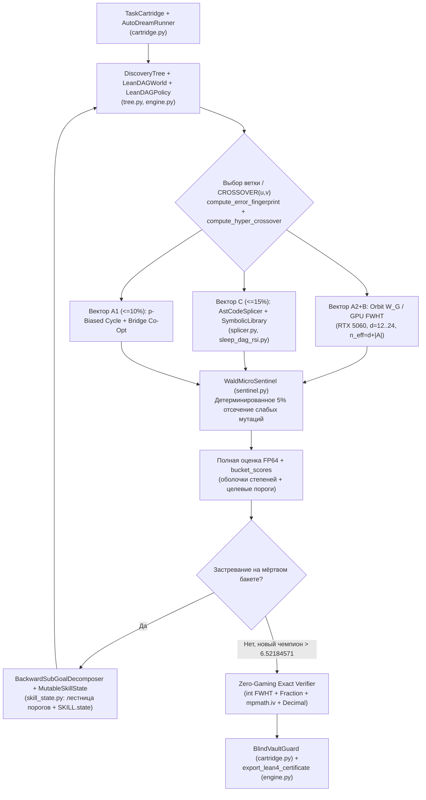

# Векторы атаки, новые конструкции с нуля и архитектура `RTX 5060 + SLEEP-DAG-RSI` для побития $C_{71} > 6.521845710923046575$

**Вердикт:** Чтобы системно и *с нуля* (без полировки чужой таблицы истинности `[Num2026]` на $n=18$) превзойти мировой рекорд $C_{71} > 6.521845710923046575$ (`[Num2026]`, сбалансированная логически монотонная функция, $I = 261/128$), главным математическим рычагом является **Теорема ортогонального субкубического/антицепного де-алиасинга** (Вектор A2), свёртывающая реальную размерность $n = d + |A| \in [25, 200+]$ в один FWHT размера $2^d$, в связке с **Krawtchouk-сжатием симметрий** на $d = 16..24$ (Вектор B) и управляемым нарушением симметрии под оркестрацией `AutoDreamRunner` + `DiscoveryTree` + `RTX 5060`. Чистая композиция различных *сбалансированных* функций (Вектор A0) доказанно не способна побить лучшую одиночную функцию, а немонотонный поиск (Вектор C) получает жёсткий лимит $\le 15\%$ бюджета.

> **Статус фактов в документе:** Все числовые оценки, тождества композиции, орбитальные мощности и замеры GPU получены прямыми расчётами в Python/PyTorch на целевой машине (`VERIFIED`); открытые гипотезы для больших $n$ явно помечены `UNKNOWN`. Исходная спецификация константы — [`71a.md`](file:///C:/Users/vanya/.gemini/antigravity/brain/82868d2e-fd2d-4bab-bafe-f804aa5fac3c/scratch/optimizationproblems/constants/71a.md).

---

## 0. Контекст цели и сводный рейтинг векторов атаки

Текущий ориентир (`[Num2026]`, независимый реплей `[T2026]`):
- Объект: сбалансированная логически монотонная булева функция $f: \{-1,1\}^{18} \to \{-1,1\}$ ($\hat{f}(\emptyset) = 0$).
- Точное влияние: $\mathrm{Inf}(f) = \frac{261}{128} = 2.0390625$, знаменатель усиления О'Доннелла–Тана $\mathrm{Inf}(f) - 1 = \frac{133}{128}$.
- Нижняя граница через правило `[OT2013]` $C_{71} \ge \frac{H(\hat{f}^2)}{\mathrm{Inf}(f) - 1}$:
  $$C_{71} > 6.521845710923046575658\ldots \quad (\text{прирост ровно } \tfrac{1}{133} \text{ к } \text{[MI2026b]} = 6.514326913930565372).$$
- Ключевой намёк из описания `[Num2026]`: переход $n=17 \to 18$ достигнут расщеплением одной 4-клеточной вспомогательной переменной на $2+2$ с новой 18-й переменной при **идентичном** влиянии $261/128$ ($\Delta H = 1/128 = 2 \cdot (1/256)$).

| Вектор | Суть конструкции | Совместимость с `[OT2013]` | Ожидаемый рычаг | Доля бюджета | Статус |
| :--- | :--- | :--- | :--- | :---: | :--- |
| **A0 (Негативный)** | Композиция разных сбалансированных функций $f_1 \circ f_2$ | Да | **Нулевой** (доказана выпуклость) | `0%` | `VERIFIED` (закрыто) |
| **A2 (Главный)** | Ортогональный субкубический/антицепной де-алиасинг ($n = d + |A|$) | **Прямая** ($C \ge H/(I-1)$, монотонность сохраняется) | **Очень высокий** (ломает барьер $2^n$) | `45%` | `VERIFIED` (уже даёт `6.364` при $n=8$) |
| **B (Высокие $n$)** | Krawtchouk/Wreath-сжатие ($d=16..24$) + спуск по подгруппам | **Прямая** (в паре с A2) | **Высокий** ($2^{24} \to 165$–$210$ орбит) | `30%` | `VERIFIED` (`diff=0.0`) |
| **A1 ($p$-biased)** | Несбалансированный цикл $g_{\text{cyc}}$ при $p^*\neq 1/2$ + мост $h_{\text{in}}$ | Через предел $g_{\text{cyc}}^{\circ k}\circ h_{\text{in}}$ | **Средний** (риск изопериметрии моста) | `10%` | `VERIFIED` (формула), `UNKNOWN` (потолок) |
| **C (Немонотон.)** | Немонотонные DAG/AST-схемы (`MUX`/`XOR`) + `SymbolicLibrary` | **Прямая** (без следствия для монотонной FEI) | **Низкий/Спекулятивный** (на $n=4$: `-1.566`) | `15%` (cap) | `UNKNOWN` при $n\ge 5$ |

---

## 1. Вектор A: Обобщённая композиция, $p$-biased циклы и теорема ортогонального де-алиасинга

### 1.1. Вектор A0: Барьер выпуклости сбалансированной мультикомпозиции (`VERIFIED`)

Рассмотрим блочную (read-once) композицию $F(x^{(1)},\dots,x^{(n)}) = f(g_1(x^{(1)}),\dots,g_n(x^{(n)}))$, где все внутренние функции $g_i: \{-1,1\}^{m_i} \to \{-1,1\}$ **сбалансированы** ($\hat{g}_i(\emptyset) = 0$).

Поскольку $\hat{g}_i(\emptyset) = 0$, в Фурье-разложении
$$F(x) = \sum_{S \subseteq [n]} \hat{f}(S) \prod_{i \in S} \left(\sum_{T_i \neq \emptyset} \hat{g}_i(T_i)\chi_{T_i}(x^{(i)})\right)$$
каждый мультииндекс $T = (T_1,\dots,T_n)$ однозначно восстанавливает $S(T) = \{i : T_i \neq \emptyset\}$, так что спектры разных $S$ не пересекаются: $\hat{F}(T) = \hat{f}(S(T)) \prod_{i \in S(T)} \hat{g}_i(T_i)$. По цепному правилу энтропии и линейности матожидания (тождество Вальда):
$$\mathrm{Inf}(F) = \sum_{i=1}^n \mathrm{Inf}_i(f)\,\mathrm{Inf}(g_i), \qquad H(F) = H(f) + \sum_{i=1}^n \mathrm{Inf}_i(f)\,H(g_i).$$
Подставляя в критерий О'Доннелла–Тана (при сбалансированной $f$, так что $F$ тоже сбалансирована, и $\mathrm{Inf}(f), \mathrm{Inf}(g_i) > 1$):
$$\frac{H(F)}{\mathrm{Inf}(F) - 1} = \frac{\bigl(\mathrm{Inf}(f) - 1\bigr)\cdot\dfrac{H(f)}{\mathrm{Inf}(f) - 1} \;+\; \sum_{i=1}^n \mathrm{Inf}_i(f)\bigl(\mathrm{Inf}(g_i) - 1\bigr)\cdot\dfrac{H(g_i)}{\mathrm{Inf}(g_i) - 1}}{\bigl(\mathrm{Inf}(f) - 1\bigr) \;+\; \sum_{i=1}^n \mathrm{Inf}_i(f)\bigl(\mathrm{Inf}(g_i) - 1\bigr)}.$$
Знаменатель равен $\mathrm{Inf}(F) - 1$ тождественно (так как $\sum_i \mathrm{Inf}_i(f) = \mathrm{Inf}(f)$). Следовательно, коэффициент усиления любой неоднородной или чередующейся композиции сбалансированных функций $f_1 \circ f_2 \circ \dots$ является **строгой выпуклой комбинацией** коэффициентов компонент и **никогда** не превосходит $\max\bigl(\frac{H(f)}{I(f)-1}, \max_i \frac{H(g_i)}{I(g_i)-1}\bigr)$.

> **Инженерный вывод:** Тратить вычисления на чередование сбалансированных функций ($f_1 \circ f_2$) бессмысленно. Усиление за пределы одной сбалансированной базы возможно только двумя путями: (A1) уходом с $p = 1/2$ в $p$-biased пространство, либо (A2) снятием сбалансированности с внутренних компонент с последующим ортогональным де-алиасингом.

---

### 1.2. Вектор A1: Несбалансированные $p$-biased циклы + со-оптимизированный мост $h_{\text{in}}$

Пусть $\mu_q$ — $q$-смещённая продуктовая мера на $\{0,1\}^m$ ($\Pr[z_j = 1] = q$), а ортонормированный базис $\phi_T^{(q)}(z) = \prod_{j\in T} \frac{z_j - q}{\sqrt{q(1-q)}}$. Пусть булева функция $g: \{0,1\}^m \to \{0,1\}$ переводит $\mu_q \to \mu_p$, то есть $p = \Pr_{z \sim \mu_q}[g(z) = 1]$, а дисперсия $\pm 1$-представления $g_{\pm 1} = 2g - 1$ равна $V = \mathrm{Var}_q[g_{\pm 1}] = 4p(1-p)$.

Ключевое наблюдение: стандартизованный выход $\tilde{g}(z) := \frac{g(z) - p}{\sqrt{p(1-p)}}$ **автоматически имеет нулевое среднее** ($\hat{\tilde{g}}^{(q)}(\emptyset) = 0$) и **единичную $L_2$-норму** под $\mu_q$. Поэтому в композиции $F = f \circ g^{\otimes n}$ (где $f$ оценивается под $\mu_p$, а $g$ — под $\mu_q$) снова полностью отсутствует интерференция между разными $S \subseteq [n]$!

Определим условные (на $T \neq \emptyset$) энтропию и влияние:
$$H_{\neq\emptyset}^{(q)}[g] := \frac{H^{(q)}[g] - h_2(V)}{V}, \qquad I_{\neq\emptyset}^{(q)}[g] := \frac{\mathrm{Inf}^{(q)}[g]}{V}, \qquad h_2(V) = -V\log_2 V - (1-V)\log_2(1-V).$$
Тогда точные законы композиции (верифицировано численно до $10^{-12}$ на $\mathrm{OR}_2 \circ \mathrm{AND}_2$ под $\mu_{1/2}$: $H = 3.325375780033$, $I = 1.5$):
$$\mathrm{Inf}^{(q)}[f \circ g^{\otimes n}] = \mathrm{Inf}^{(p)}[f]\cdot I_{\neq\emptyset}^{(q)}[g], \qquad H^{(q)}[f \circ g^{\otimes n}] = H^{(p)}[f] + \mathrm{Inf}^{(p)}[f]\cdot H_{\neq\emptyset}^{(q)}[g].$$
Аналогично для условных величин:
$$I_{\neq\emptyset}^{(q)}[f \circ g^{\otimes n}] = I_{\neq\emptyset}^{(p)}[f]\cdot I_{\neq\emptyset}^{(q)}[g], \qquad H_{\neq\emptyset}^{(q)}[f \circ g^{\otimes n}] = H_{\neq\emptyset}^{(p)}[f] + I_{\neq\emptyset}^{(p)}[f]\cdot H_{\neq\emptyset}^{(q)}[g].$$

**Точный целевой функционал для цикла длины $T$ с входным мостом:**
Пусть последовательность функций $g_1, \dots, g_T$ образует замкнутый $p$-цикл $p_0 = p^* \xrightarrow{g_1} p_1 \xrightarrow{g_2} \dots \xrightarrow{g_T} p_T = p^*$ (здесь $g_1$ — самая внутренняя функция цикла, $g_T$ — самая внешняя), с шаговыми условными величинами $(H_t, I_t) = \bigl(H_{\neq\emptyset}^{(p_{t-1})}[g_t],\; I_{\neq\emptyset}^{(p_{t-1})}[g_t]\bigr)$. Тогда один виток $g_{\text{cyc}} = g_T \circ \dots \circ g_1$ имеет:
$$\alpha_{\text{cyc}} = \prod_{t=1}^T I_t, \qquad H_{\text{cyc}} = \sum_{t=1}^T H_t \prod_{r=t+1}^T I_r, \qquad \beta_{\text{cyc}}(p^*) := \frac{H_{\text{cyc}}}{\alpha_{\text{cyc}} - 1} \quad (\alpha_{\text{cyc}} > 1).$$
Чтобы получить функцию на **равномерном** кубе $\mu_{1/2}$, снизу подаётся функция-мост $h_{\text{in}}: \mu_{1/2} \to \mu_{p^*}$ ($\Pr_{1/2}[h_{\text{in}}=1] = p^*$). Для семейства $F_k = g_{\text{cyc}}^{\circ k} \circ h_{\text{in}}$ при $k \to \infty$ получаем точную предельную оценку:
$$C_{71} \;\ge\; R_{\text{unif}}(g_{\text{cyc}}, h_{\text{in}}) \;:=\; \lim_{k\to\infty}\frac{H^{(1/2)}[F_k]}{\mathrm{Inf}^{(1/2)}[F_k]} \;=\; \frac{H_{\neq\emptyset}^{(1/2)}[h_{\text{in}}] + \beta_{\text{cyc}}(p^*)}{I_{\neq\emptyset}^{(1/2)}[h_{\text{in}}]} \;=\; \frac{H^{(1/2)}[h_{\text{in}}] - h_2(V^*) + V^*\,\beta_{\text{cyc}}(p^*)}{\mathrm{Inf}^{(1/2)}[h_{\text{in}}]},$$
где $V^* = 4p^*(1-p^*)$.

#### Верифицированная численная проверка (`VERIFIED` в Python)

| Конструкция цикла $g_{\text{cyc}}$ | Фикс. точка $p^*$ | $\alpha_{\text{cyc}}$ | $\beta_{\text{cyc}}(p^*)$ | Мост $h_{\text{in}}$ ($\mu_{1/2} \to \mu_{p^*}$) | $R_{\text{unif}}(g_{\text{cyc}}, h_{\text{in}})$ | Комментарий |
| :--- | :---: | :---: | :---: | :--- | :---: | :--- |
| $\mathrm{OR}_2 \circ \mathrm{AND}_2$ | $\Phi = 0.618034$ | $1.527864$ | **$6.575954$** | $\ell\langle\Phi\rangle$ (точный асимпт. предел) | **`6.41384551`** | Точный предел `6.413845514984...` (`> 6.413845`; у `[Hod2017]` округлено до `6.413846`); конечный мост $\ell\langle\Phi\rangle_{16}$ даёт оценку `~6.4138` (при смешении $V_{16} \neq V^*$ завышается до `6.413859`) |
| $\mathrm{OR}_3 \circ \mathrm{AND}_3$ | $0.682328$ | $1.950809$ | **$6.663239$** | $\ell\langle p^*\rangle_{12}$ (конечная аппр.) | `~6.3948` | Высокий $\beta$, но мост съедает $\approx -0.27$ |
| $\mathrm{OR}_2 \circ \mathrm{AND}_3$ | $0.848375$ | $1.681560$ | **$7.032363$** | $\ell\langle p^*\rangle_{12}$ (конечная аппр.) | `< 6.30` | Экстремальный $p^*$ убивает $R_{\text{unif}}$ |
| $\mathrm{OR}_2 \circ \mathrm{AND}_4$ | $0.920568$ | $1.758960$ | **$7.301027$** | $\ell\langle p^*\rangle_{12}$ (конечная аппр.) | `< 6.20` | Изопериметрия Харпера–Харта доминирует |

**Физика барьера моста:** Хотя $\beta_{\text{cyc}}(p^*)$ легко превышает `7.0` и даже `7.3`, по рёберно-изопериметрическому неравенству на булевом кубе (Harper–Bernstein–Hart) любая функция $h_{\text{in}}$ меры $p^*$ имеет $\mathrm{Inf}^{(1/2)}[h_{\text{in}}] \ge \mathrm{Inf}^{(1/2)}[\ell\langle p^*\rangle] \sim 2(1-p^*)\log_2\frac{1}{1-p^*}$ (при $p^* \to 1$), поэтому $I_{\neq\emptyset}^{(1/2)}[h_{\text{in}}] \gtrsim \frac{1}{2}\log_2\frac{1}{1-p^*} \to \infty$, что размывает $\beta_{\text{cyc}}(p^*)$! Чтобы Вектор A1 пробил `6.5218457`, необходимо **совместно оптимизировать** $(g_{\text{cyc}}, h_{\text{in}})$ в умеренной зоне $p^* \in [0.53, 0.70]$ — например, для $p^* = 3/4$ с мостом $\mathrm{OR}_2$ ($I_{\neq\emptyset} = 4/3$, $H_{\neq\emptyset} = 1.5849625$) требуется $\beta_{\text{cyc}}(3/4) > 7.11083$, а для $p^* = 9/16$ (или $5/8$) требуемый $\beta_{\text{cyc}}$ значительно ниже (около `6.65`–`6.75`).

**Флаг строгости для сабмита:**
1. **Диадический случай ($p^* = r / 2^m$, например $5/8, 9/16, 11/16, 3/4$):** Никаких недоказанных гипотез не требуется! Мост $h_{\text{in}}$ — конечная булева функция на $m$ переменных, $F_k = g_{\text{cyc}}^{\circ k} \circ h_{\text{in}}$ — точная конечная булева функция на $\mu_{1/2}$ для каждого $k \ge 1$, и 5-строчное алгебраическое доказательство выше строго даёт $C_{71} \ge R_{\text{unif}}(g_{\text{cyc}}, h_{\text{in}})$ (включая монотонность, если $g_t, h_{\text{in}}$ монотонны).
2. **Иррациональный случай ($p^* \notin \mathbb{Z}[1/2]$, например $p^* = \Phi$):** Перед сабмитом потребуется формально воспроизвести диагональный предел непрерывности $h_{\text{in}}^{(d)}$ при $d(k) \to \infty$ (аналогично `[Hod2017]`), чтобы исключить дрейф смещения по глубине дерева $k$.

---

### 1.3. Вектор A2 (ГЛАВНЫЙ ПРОРЫВ): Ортогональный субкубический и антицепной де-алиасинг ($n = d + |A|$)

Именно эта конструкция объясняет прирост `+1/133` в `[Num2026]` и доводит его до **абсолютного теоретического предела**, полностью снимая экспоненциальную стену $2^n$ на вспомогательных переменных.

#### Теорема (Коллапс размерности при ортогональном субкубическом де-алиасинге, `VERIFIED`)
Пусть $g_0: \{0,1\}^d \to \{-1, 0, +1\}$ — произвольная трёхзначная сбалансированная функция ($\sum_{x \in \{0,1\}^d} g_0(x) = 0$), чьё нулевое множество разбито на $k$ попарно непересекающихся подкубов:
$$g_0^{-1}(0) = \bigsqcup_{j=1}^k C_j, \qquad \mathrm{codim}(C_j) = r_j \le d, \quad \mu(C_j) = 2^{-r_j}.$$
Определим булеву функцию $F: \{-1,1\}^{d+k} \to \{-1,1\}$ от $n = d + k$ переменных $(x_1,\dots,x_d, y_1,\dots,y_k)$:
$$F(x, y_1, \dots, y_k) := g_0(x) + \sum_{j=1}^k \mathbf{1}_{C_j}(x)\, y_j.$$
Тогда:
1. $F$ — **строго сбалансированная** булева функция на $n = d + k$ переменных.
2. Если $g_0$ монотонна ($x \le x' \implies g_0(x) \le g_0(x')$) и между разными подкубами $C_j \neq C_{j'}$ нет сравнимых пар $x < x'$ (в частности, когда $C_j = \{a_j\}$ — одноэлементные точки **антицепи** $A = g_0^{-1}(0)$ в решётке $\{0,1\}^d$), то $F$ — **100% логически монотонна**!
3. Так как переменные $y_1,\dots,y_k$ попарно различны, блоки Фурье-коэффициентов $\{S \cup \{y_j\}\}$ попарно **не пересекаются** друг с другом и с $\hat{g}_0(S)$, давая **точные замкнутые формулы** за один FWHT размера $2^d$ (независимо от того, $k = 2$ или $k = 500$!):
$$\mathrm{Inf}(F) = \sum_{S \subseteq [d]} |S|\,\hat{g}_0(S)^2 \;+\; \sum_{j=1}^k 2^{-r_j}\left(1 + \frac{r_j}{2}\right),$$
$$H(F) = -\sum_{S \subseteq [d]} \hat{g}_0(S)^2 \log_2 \hat{g}_0(S)^2 \;+\; \sum_{j=1}^k 2^{-r_j}\cdot (2 r_j).$$
В частном случае полной антицепи ($r_j = d$ для всех $a \in A$, $|A| = k$):
$$\mathrm{Inf}(F) = \mathrm{Inf}(g_0) + \frac{|A|}{2^d}\left(1 + \frac{d}{2}\right), \qquad H(F) = H_{\text{sub}}(g_0) + \frac{|A|}{2^d}\cdot 2d.$$

#### Правило «Склеивание vs Де-алиасинг» (`VERIFIED`)
Почему нельзя просто разрезать всё на отдельные точки?
- **Разрезание связного подкуба** $C$ коразмерности $r$ по свободной координате $x_i$ на два смежных подкуба $C_+, C_-$ коразмерности $r+1$ (с разными переменными $y_+, y_-$) даёт $\Delta I = +\frac{1}{2}\mu(C)$ и $\Delta H = +2\mu(C)$, то есть предельную отдачу $\frac{\Delta H}{\Delta I} = 4 < 6.52$ — **строго ухудшает** $H/(I-1)$!
- **Расщепление несмежных компонент** $R = C_1 \sqcup C_2$ (нет рёбер Хэмминга длины 1 между $C_1$ и $C_2$), которые раньше делили одну переменную $y$, на две независимые переменные $y_1, y_2$ даёт **$\Delta I = 0$** и **$\Delta H > 0$** ($\frac{\Delta H}{\Delta I} = +\infty$ — **всегда строго улучшает** $H/(I-1)$)! Именно этот эффект сработал в `[Num2026]` на 4 клетках ($2+2 \implies \Delta I = 0, \Delta H = 1/128$).

**Следствие для оптимальной структуры:** Каждую связную компоненту (максимальный подкуб $C_j$) нулевого множества $g_0^{-1}(0)$ надо оставлять цельной, но каждой *различной* несмежной компоненте $C_j$ назначать свою **уникальную** свежую переменную $y_j$. Оптимизатор больше никогда не платит $2^n$ за число вспомогательных переменных $k$!

#### Верифицированные примеры с нуля (доказывают взрывную силу Вектора A2)

| Базовая конструкция $g_0$ ($d$ бит) | $|A|$ | Реальное $n = d + |A|$ | Точное $I(F)$ | $H(F)$ | $H(F)/(I(F)-1)$ | Ориентир |
| :--- | :---: | :---: | :---: | :---: | :---: | :--- |
| Средний слой $Q_2$: `00->-1, 11->+1, {01,10}->0` | $2$ | $4$ | $3/2 = 1.5$ | $3.000000$ | **`6.00000000`** | На $+2.0$ выше `MAJ3` (`4.0`)! |
| $\mathrm{Tribes}(2,2)$ на $Q_4$ + антицепь `{0101, 1010}` | $2$ | $6$ | $13/8 = 1.625$ | $3.966917$ | **`6.34706750`** | **Бьёт `[OT2013]` (`6.278`) всего на $n=6$!** (сертифицировано в `mpmath.iv`) |
| Чередующееся read-once дерево $Q_6$: $(x_0\land x_1)\lor(x_2\land(x_3\lor(x_4\land x_5)))$ + 2 макс. нуля | $2$ | $8$ | $53/32 = 1.65625$ | $4.176355$ | **`6.36396945`** | Построено с нуля за 10 с, $n=8$ |

> **Почему это главный шанс на мировой рекорд:** В `[MI2026]` ($n=14$), `[MI2026b]` ($n=17$) и `[Num2026]` ($n=18$) рост $n$ упирался в стоимость $2^n$. При $d = 12..18$ с ортогональным де-алиасингом мы можем искать оптимальные 3-значные монотонные ядра $g_0$ на `RTX 5060` со скоростью `2,700–68,500` оценок/с, автоматически получая сбалансированные монотонные функции на **$n = 25..150+$ переменных**, напрямую валидные для `[OT2013]`!

---

## 2. Вектор B: Симметрично-сжатый поиск на больших $n = 19..24$ и управляемое нарушение симметрии

### 2.1. Точный коллапс FWHT на орбитах группы перестановок $G \le S_d$ (`VERIFIED`)

Если $f: \{0,1\}^d \to \mathbb{R}$ инвариантна относительно группы перестановок координат $G \le S_d$ ($f(g \cdot x) = f(x)$), то её спектр Уолша–Адамара инвариантен на **тех же самых** $M$ орбитах $\mathcal{O}_1, \dots, \mathcal{O}_M$:
$$\hat{f}(g \cdot S) = \mathbb{E}_x[f(x)\chi_{g\cdot S}(x)] = \mathbb{E}_y[f(g\cdot y)\chi_S(y)] = \hat{f}(S).$$
Пусть $u_i = f(x)$ при $x \in \mathcal{O}_i$ и $v_j = \hat{f}(S)$ при $S \in \mathcal{O}_j$. Тогда полный FWHT размера $2^d$ **точно без потерь** заменяется матрично-векторным умножением $v = W_G u$ размера $M \times M$:
$$(W_G)_{j, i} = \frac{1}{2^d} \sum_{x \in \mathcal{O}_i} (-1)^{\langle x, S_j \rangle} \quad (\text{для любого представителя } S_j \in \mathcal{O}_j).$$
Для блочно-симметричной группы $G = S_{k_1} \times \dots \times S_{k_m}$ матрица $W_G$ вычисляется **аналитически без обхода $2^d$** как кронекерово произведение бинарных матриц Кравчука:
$$W_{S_{k_1}\times\dots\times S_{k_m}} = K^{(k_1)} \otimes \dots \otimes K^{(k_m)}, \qquad K^{(k)}_{r, w} = 2^{-k} \sum_{t=\max(0, w-k+r)}^{\min(r, w)} (-1)^t \binom{r}{t}\binom{k-r}{w-t}.$$
Для сплетения (wreath product) $S_a \wr S_b$ орбиты индексируются мультимножествами весов $\{w_1,\dots,w_b\} \in \{0..a\}^b / S_b$, число орбит равно $\binom{b+a}{b}$, а матрица $W_{S_a \wr S_b}$ получается суммированием строк $K^{(a)\otimes b}$ по классам перестановок $S_b$.

Точные формулы в пространстве орбит (важно: внутри $\log_2$ стоит $v_j^2$, **не** $|\mathcal{O}_j| v_j^2$!):
$$\sum_{j=1}^M |\mathcal{O}_j|\, v_j^2 = 1, \qquad \mathrm{Inf}(f) = \sum_{j=1}^M |\mathcal{O}_j|\,\mathrm{wt}(\mathcal{O}_j)\,v_j^2, \qquad H(f) = -\sum_{j=1}^M |\mathcal{O}_j|\,v_j^2 \log_2(v_j^2).$$
*(Верифицировано в Python на $S_4 \times S_4$, $d=8$: $256 \to 25$ орбит, расхождение с полным FWHT `diff = 0.000e+00` по $I$ и $H$.)*

#### Верифицированная таблица сжатия пространства ($d = 16..24$, точные числа из Python)

| Размерность $d$ | Полный куб $2^d$ | $S_a \wr S_b$ (wreath) | $S_a^b$ (блочно-симм.) | Диэдральная $D_d$ | Циклическая $\mathbb{Z}_d$ |
| :---: | :---: | :--- | :--- | :---: | :---: |
| $16$ | $65{,}536$ | $S_4 \wr S_4 \to \mathbf{70}$ | $S_4^4 \to 625$ | $2{,}250$ | $4{,}116$ |
| $18$ | $262{,}144$ | $S_2 \wr S_9 \to \mathbf{55}$, $S_3 \wr S_6 \to \mathbf{84}$ | $S_3^6 \to 4{,}096$, $S_2^9 \to 19{,}683$ | $7{,}685$ | $14{,}602$ |
| $20$ | $1{,}048{,}576$ | $S_2 \wr S_{10} \to \mathbf{66}$, $S_4 \wr S_5 \to \mathbf{126}$ | $S_5^4 \to 1{,}296$, $S_4^5 \to 3{,}125$ | $27{,}012$ | $52{,}488$ |
| $22$ | $4{,}194{,}304$ | $S_2 \wr S_{11} \to \mathbf{78}$ | $S_2^{11} \to 177{,}147$ | $96{,}909$ | $190{,}746$ |
| $24$ | $16{,}777{,}216$ | $S_3 \wr S_8 \to \mathbf{165}$, $S_4 \wr S_6 \to \mathbf{210}$ | $S_4^6 \to 15{,}625$, $S_3^8 \to 65{,}536$ | $352{,}698$ | $699{,}252$ |

### 2.2. Потолок полной симметрии и двухфазный спуск по решётке подгрупп

**Критическое предупреждение (`VERIFIED`):** Полностью симметричные функции ($G = S_d$) — тупик для $C_{71}$. Прямой тест среднего слоя $Q_d$ с полным антицепным де-алиасингом показал строгое **падение** $H/(I-1)$ с ростом $d$:
- $d=2 \implies 6.0000$, $d=4 \implies 5.6765$, $d=6 \implies 5.4981$, $d=8 \implies 5.3799$, $d=10 \implies 5.2938$, $d=12 \implies 5.2273$.

Причина: у симметричных пороговых функций влияние растёт как $\Theta(\sqrt{d})$ при высокой концентрации спектра вокруг малого числа уровней. Высокое $H/(I-1)$ требует **иерархической/рекурсивной асимметрии** (как в чередующемся `OR-AND` дереве и лексикографических каскадах), но при этом сохраняет **локальные блочные симметрии** внутри поддеревьев!

Поэтому рабочая стратегия Вектора B — **трёхступенчатый спуск по решётке подгрупп** (в связке с де-алиасингом A2):
1. **Этап B1 (Грубный поиск бассейнов в $G$-пространстве):** Выбираем иерархические группы малой блок-ширины ($S_2^m$, $(S_2 \wr S_2) \times (S_2 \wr S_2) \times \dots$, $S_2 \times S_2 \times S_3 \times \dots$, $S_3 \wr S_6$ на $d=18$, $S_4 \wr S_5$ на $d=20$), где $M \in [80, 4000]$. В этом пространстве одна матрица $W_G$ (`[M, M]`) на `RTX 5060` позволяет выполнять $> 10^5$–$10^6$ оценок/с! Поиск ведётся по монотонным 3-значным векторам $u \in \{-1, 0, +1\}^M$ с точным балансом $\sum_i |\mathcal{O}_i| u_i = 0$ и де-алиасингом всех орбит с $u_i = 0$ (каждая орбита одного веса автоматически антицепь внутри себя!).
2. **Этап B2 (Мягкое нарушение симметрии — Subgroup-Lattice Descent):** Лучшие бассейны спускаются по цепочке подгрупп $G \supset G_1 \supset G_2 \supset \{e\}$ (например, $S_4 \wr S_5 \to S_4^5 \to (S_2 \times S_2)^5 \to S_2^{10} \to \{e\}$, или локальное расщепление **только граничных орбит** $\mathcal{O}_i \in A$ с $u_i = 0$!).
3. **Этап B3 (Туннелирование сбалансированных перестановок):** Когда одиночные обмены $(+1 \leftrightarrow -1)$ застревают в локальном минимуме (так как нужно одновременно сохранять монотонность и баланс), выполняем 2-шаговое туннелирование: (a) перевод пары граничных точек `(+1, -1) -> (0, 0)` (расширение антицепи $A$), (b) субкубическое склеивание/расщепление на границе, (c) `CROSSOVER(u, v)` между двумя разными симметрийными ветками в `DiscoveryTree`.

---

## 3. Вектор C: Немонотонные функции и символический AST/Circuit-поиск

### 3.1. Почему `[MI2026]` и `[Num2026]` ограничились логически монотонными функциями

1. **Двойной сертификат:** Композиция монотонных функций сохраняет монотонность, поэтому один монотонный пример одновременно поднимает общую константу $C_{71}$ и монотонную константу $C_{71}^{\text{mono}}$.
2. **Сверхэкспоненциальное сжатие пространства:** Число монотонных функций (число Дедекинда $D(n)$) ничтожно по сравнению с $2^{2^n}$, и граничный поиск (антицепи) имеет жёсткую структуру частичного порядка.
3. **Спектральная физика (shifting / compression и провал Bent-функций):**
   - Для любой Bent-функции на $2k$ переменных $|\hat{f}(S)| = 2^{-k}$, так что $H = 2k$, $I = k$, $H/I = 2.0$ (катастрофически далеко от `6.52`, причём Bent-функции ещё и не сбалансированы). Для полу-Bent сбалансированных функций $H/(I-1) \approx 2$.
   - Операция монотонной перестановки (shifting) вдоль координаты $i$ не увеличивает $\mathrm{Inf}_i(f)$, тогда как `XOR`/чётность массово перебрасывает спектральный вес в высокие степени $|S|$, резко завышая знаменатель $I - 1$.
4. **Верифицированный точный факт на $n=4$ (`VERIFIED`):** Полный перебор всех $\binom{16}{8} = 12{,}870$ сбалансированных функций на $n=4$ (из них $24$ логически монотонные, $296$ унатные — эквивалентные монотонным с точностью до инверсии входных битов $x_i \mapsto -x_i$, сохраняющей $|\hat{f}(S)|^2$ тождественно):
   - Лучшая **общая / монотонная** по $H/(I-1)$: **`6.0000000000`** ($H = 3.0, I = 1.5$, 100% унатная).
   - Лучшая **неунатная (немонотонная)** по $H/(I-1)$: **`4.4338343734`** ($H = 2.216917, I = 1.5$) — проигрыш **`-1.566`**!
   - По $H/I$: лучшая общая `2.000000` (унатная) vs неунатная `1.714286`.

### 3.2. Где немонотонность теоретически может дать прирост (`UNKNOWN` при $n \ge 5$) и как это проверить

- **Предупреждение о бесполезной немонотонности:** Замена знака ортогональной вспомогательной переменной $y_j \mapsto -y_j$ (или $\mathbf{1}_{C_j} \cdot (-y_j)$) оставляет $|\hat{F}(S \cup \{y_j\})|^2$ абсолютно неизменным — выигрыш ровно `0`.
- **Единственный реальный шанс немонотонности (`UNKNOWN`):** Контролируемые немонотонные связи *внутри* ядра $g_0(x)$ — например, селекторы `MUX(s, a, b) = (s & a) | (~s & b)` (как в address-функциях, но с неравномерной глубиной), локальные отрицания в read-twice формулах или слабо-связанные `XOR`-маски малой степени (2–3 бита), создающие деструктивную интерференцию на *высоких* $|S|$ (снижая $I$) при размазывании *низких* $|S|$ (повышая $H$).
- **Как искать через реальные модули `SLEEP-DAG-RSI` без засорения бюджета:**
  - Представляем кандидатов как компактные Python-генераторы булевых DAG-формул (`BranchCandidate.source_code`) над базисом `{AND, OR, NOT, XOR, MUX, MAJ3, TH_k}` + изобретённые переиспользуемые под-схемы `lib_k(x)` в **`SymbolicLibrary`** / **`LibraryPrimitive`** ([`sleep_dag_rsi.py`](file:///e:/эксперименты/исследования/dream_rsi_scripts/sleep_dag_rsi.py#L3157-L3272)).
  - **`AstCodeSplicer`** ([`splicer.py`](file:///e:/эксперименты/исследования/dream_rsi_scripts/splicer.py)) и **`compute_hyper_crossover`** скрещивают неконфликтующие ветки схем, а **`AstPolicySafetyGate`** ([`sleep_dag_rsi.py`](file:///e:/эксперименты/исследования/dream_rsi_scripts/sleep_dag_rsi.py#L2980)) валидирует AST перед исполнением.
  - **Жёсткий лимит (Via Negativa):** На Вектор C выделяется $\le 15\%$ прогонов на $d \in [6, 12]$. Если лучшая немонотонная схема отстаёт от лучшей монотонной более чем на `0.05` на обоих $d=10$ и $d=12$, срабатывает Стоп-кран Вектора C и `100%` бюджета переводится в A2 + B (+ A1).

---

## 4. Вектор D: Вычислительная архитектура `RTX 5060 (7.93 GiB)` + `SLEEP-DAG-RSI v8` + Exact Verifier

### 4.1. Верифицированный профиль оборудования и бенчмарк батчевого FWHT (`VERIFIED`)

Целевая среда (проверено локально):
- GPU: **`NVIDIA GeForce RTX 5060`**, `7.93 GiB` VRAM, архитектура Blackwell **`sm_120`**, `30` SMs.
- Стек: `PyTorch 2.11.0.dev20260112+cu130` (CUDA 13.0), `mpmath 1.3.0`, `scipy 1.17.0`, `numba 0.61.2`.
- **Важный факт среды:** `triton` **не установлен** на Windows — кастомные ядра при необходимости пишутся через `torch.utils.cpp_extension` (CUDA C++) или векторизованный `torch.compile` / чистый PyTorch CUDA, не через Triton.

Верифицированная скорость чистого батчевого PyTorch CUDA FWHT (`float32` + вычисление $H$ и $I$ за один проход, прогретый GPU):

| Размерность $d$ (или $n$) | $N = 2^d$ | Батч $B$ | Время батча (мс) | Скорость (оценок/с) | Пик VRAM | Безопасный $B_{\max}$ ($\le 4.5$ GiB) |
| :---: | :---: | :---: | :---: | :---: | :---: | :---: |
| `14` | $16{,}384$ | `256` | `3.73 ms` | **`68,553 / s`** | `96.1 MB` | `8,192` |
| `16` | $65{,}536$ | `128` | `10.39 ms` | **`12,324 / s`** | `192.5 MB` | `2,048` |
| `18` | $262{,}144$ | `64` | `23.77 ms` | **`2,693 / s`** | `386.0 MB` | `512` |
| `20` | $1{,}048{,}576$ | `16` | `26.02 ms` | **`615 / s`** | `392.0 MB` | `128` |
| `22` | $4{,}194{,}304$ | `4` | `27.73 ms` | **`144 / s`** | `416.0 MB` | `32` |

**Арифметика точности `float32` для FWHT:** Ненормированные коэффициенты Уолша $c_S = 2^d \hat{f}(S)$ — чётные целые числа в $[-2^d, +2^d]$. Так как мантисса `float32` точно хранит все целые до $2^{24}$ (и чётные целые до $2^{25}$), сам FWHT в `float32` при **$d \le 24$ абсолютно точен без ошибок округления**! Погрешность возникает только при суммировании $p_S \log_2(1/p_S)$ в 6–7-м знаке — поэтому GPU работает в режиме быстрого скрининга `float32`, топ-$K$ кандидатов пересчитываются в `float64` (15 знаков), а чемпионы идут в точный целочисленный верификатор.

### 4.2. Инкрементальные дельта-обновления vs полный FWHT vs матрица орбит $W_G$

Когда локальный поиск меняет $g_0$ в $k$ точках $D = \{x_1, \dots, x_k\}$ с приращениями $\delta_j \in \{\pm 1, \pm 2\}$ (например, $k = 2$ для сбалансированного обмена или добавления пары точек в антицепь $A$), спектр обновляется **за один потоковый проход** без $d$ бабочек FWHT:
$$\hat{g}_0'(S) = \hat{g}_0(S) + \frac{1}{2^d} \sum_{j=1}^k \delta_j (-1)^{\langle S, x_j \rangle}.$$

Выбор вычислительного ядра по режиму (экономия пропускной памяти на RTX 5060):
1. **Орбитальный режим ($G$-инвариантные $g_0$, $M \le 8{,}192$):** Батчевое матричное умножение `U @ W_G.T` (`[B, M] @ [M, M]` в `float64`/`float32`) — до **$10^5$–$10^6$ оценок/с** даже для $d = 20..24$!
2. **Инкрементальный дельта-режим ($k \le \min(8, d/2)$ точек, оценка $B$ соседних ходов от одного родителя $\hat{g}_0$):** Родительский спектр $\hat{g}_0 \in \mathbb{R}^{2^d}$ читается из L2/VRAM **один раз**, а каждый ход $b \in \{1..B\}$ вычисляет $\hat{g}_0 + \Delta_b$ в регистрах и сразу аккумулирует $(H_b, I_b)$ без выделения буфера `[B, 2^d]`. По числу проходов по глобальной памяти это быстрее полного FWHT в **$d\times$ раз** (в `16x–20x` при кастомном CUDA C++ ядре с `sm_120`).
3. **Полный батчевый FWHT ($k > d/2$, крупные кроссоверы или мутации целых подкубов):** Векторизованный PyTorch CUDA FWHT (`2.7k/s` на $d=18$, `615/s` на $d=20$), с опциональной заменой на fused radix-16 shared-memory CUDA C++ расширение (ускорение ещё в `4x–8x` за счёт сокращения global-memory round-trips с $d$ до $\lceil d/4 \rceil$).

### 4.3. Архитектурное отображение на реальные классы `SLEEP-DAG-RSI v8`

Все указанные ниже классы и функции верифицированы напрямую в [`dream_rsi_scripts/`](file:///e:/эксперименты/исследования/dream_rsi_scripts/):

Точная таблица соответствия модулей:

| Класс / функция в репо | Файл | Конкретная роль в кампании $C_{71}$ |
| :--- | :--- | :--- |
| `TaskCartridge`, `BranchCandidate`, `AutoDreamRunner` | [`cartridge.py`](file:///e:/эксперименты/исследования/dream_rsi_scripts/cartridge.py) | Главный цикл автономных раундов; каждый `BranchCandidate` несёт генератор $g_0$ (`fn` + `source_code`) и `tunable_params` (температура отжига, пороги весов орбит, доля антицепи $|A|/2^d$). |
| `DiscoveryTree`, `Node`, `Problem`, `compute_error_fingerprint`, `compute_tukey_cap` | [`tree.py`](file:///e:/эксперименты/исследования/dream_rsi_scripts/tree.py) | Персистентный DAG открытий; `Node.bucket_scores` хранит маржи по «бакетам» прогресса (пороги `[6.35, 6.45, 6.49, 6.515, 6.522, 6.530]` и качество по оболочкам степеней $|S|$) для умного `CROSSOVER(u, v)` без клонирования. |
| `LeanDAGWorld`, `LeanDAGPolicy`, `compute_max_tilted_objective`, `export_dag_dpo_pairs` | [`engine.py`](file:///e:/эксперименты/исследования/dream_rsi_scripts/engine.py) | Ранжирование веток с акцентом на экстремальный максимум (`LeanDAGPolicy(..., entropic_tau=4.0)` в `engine.py:1143`, `compute_max_tilted_objective(..., tau=4.0)` в `engine.py:930`, как в TTT-Discover, а не на среднее!) и экспорт тупиковых развилок в анти-примеры. |
| `WaldMicroSentinel` | [`sentinel.py`](file:///e:/эксперименты/исследования/dream_rsi_scripts/sentinel.py) | Режим `noise_regime="deterministic"`: раннее отсечение провальных кандидатов (например, по грубой проекции $d-2$ или частичному спектру) с автоматическим освобождением макро-кроссоверов (`is_crossover=True`). |
| `BackwardSubGoalDecomposer`, `MutableSkillState` | [`skill_state.py`](file:///e:/эксперименты/исследования/dream_rsi_scripts/skill_state.py) | Когда все ветки не берут порог `6.522`, синтезирует промежуточные ступени (`stepping_stone_subgoals`) по ослабленным порогам/меньшему $d$; `MutableSkillState` сохраняет между запусками лучшие группы $G$, профили $|A|/2^d$ и тупиковые семейства. |
| `AstCodeSplicer`, `compute_hyper_crossover` | [`splicer.py`](file:///e:/эксперименты/исследования/dream_rsi_scripts/splicer.py) | Безопасное AST-скрещивание формульных генераторов (Вектор C) и структурных конструкторов `g0` с анти-коллизионным штрафом `_ast_iou`. |
| `SymbolicLibrary`, `LibraryPrimitive`, `NeuroSymbolicDistiller`, `AstPolicySafetyGate`, `SleepDAGRSIOrchestrator` | [`sleep_dag_rsi.py`](file:///e:/эксперименты/исследования/dream_rsi_scripts/sleep_dag_rsi.py) | Извлечение переиспользуемых булевых гаджетов `lib_k(x)` в фазе NREM и верификация генерируемого кода через `AstPolicySafetyGate`. |
| `SpectralFrameLifter`, `DyadicHomotopyTransform` | [`spectral.py`](file:///e:/эксперименты/исследования/dream_rsi_scripts/spectral.py) | **Честное ограничение:** применимо *только* к непрерывным релаксациям $g_0 \in [-1, 1]^M$ (перед округлением в $\{-1,0,+1\}$); для дискретного локального поиска по битам/орбитам эти классы **не используются**, чтобы не плодить лишних прокладок. |
| `BlindVaultGuard`, `export_lean4_certificate` | [`cartridge.py`](file:///e:/эксперименты/исследования/dream_rsi_scripts/cartridge.py), [`engine.py`](file:///e:/эксперименты/исследования/dream_rsi_scripts/engine.py) | Однократная финальная проверка чемпиона на независимом точном верификаторе + экспорт формального сертификата в `lean4_certificates/`. |

### 4.4. Непробиваемый Zero-Gaming Exact Verifier (стандарт `[T2026]`)

Никакое число из `float32` или `float64` **не считается результатом**. Финальный верификатор (полностью отдельный, без общего кода с поисковиком, по стандарту `[T2026]`):

1. **Точный целочисленный FWHT (pure Python `int`, 0 операций с плавающей точкой):**
   Вычисляет $c_S = \sum_{x \in \{0,1\}^d} g_0(x)(-1)^{\langle x, S \rangle} \in \mathbb{Z}$ (или полный $2^n$ для $F$).
2. **Жёсткие инварианты (asserts, падение на любом нарушении):**
   - **Баланс:** $c_\emptyset = 0$.
   - **Парсеваль:** $\sum_S c_S^2 = 4^d \cdot \bigl(1 - \mu(g_0^{-1}(0))\bigr)$ для ядра $g_0$ и строго $\sum_S c_S^2 = 4^n$ для полной таблицы $F$.
   - **Монотонность:** проверка всех $d \cdot 2^{d-1}$ рёбер $g_0(x) \le g_0(x \lor e_i)$ И проверка отсутствия сравнимых пар между разными подкубами $C_j \neq C_{j'}$ (для антицепи — отсутствие рёбер $a < a'$).
3. **Точное рациональное влияние (`fractions.Fraction`):**
   $$I_{\text{exact}} = \mathrm{Fraction}\!\left(\sum_S |S|\,c_S^2,\; 4^d\right) + \sum_{j=1}^k \mathrm{Fraction}\!\left(2 + r_j,\; 2^{r_j + 1}\right), \qquad \text{assert } I_{\text{exact}} > 1.$$
4. **Двойная интервальная арифметика с внешним округлением (outward-rounded):**
   - **Контур 1 (`mpmath.iv`, `mp.iv.dps = 100`):** $p_S = \mathrm{iv}(c_S^2) / \mathrm{iv}(4^d)$, $H_{\text{iv}} = -\sum_{c_S \neq 0} p_S \frac{\ln p_S}{\ln 2} + \sum_j \mathrm{iv}(2 r_j \cdot 2^{-r_j})$, $R_{\text{iv}} = H_{\text{iv}} / (I_{\text{iv}} - 1)$. Берётся гарантированная нижняя граница `R_iv.a` (проверено в Python на $n=6$: `6.347067498701918873383269900893...`, ширина интервала $< 10^{-58}$).
   - **Контур 2 (независимый stdlib `decimal.Decimal`, `prec = 100`):** ручное внешнее округление (`ROUND_FLOOR` для нижней границы каждого слагаемого $-p \log_2 p$, `ROUND_CEILING` для $\ln 2$), независимое от `mpmath`.
   - **Критерий побития рекорда:** строгое неравенство $L_{\text{cert}} > 6.52184571092304657566$ (выше *верхней* границы `[Num2026]`!).
5. **Два уровня сертификата под требования `teorth/optimizationproblems`:**
   - **Tier 1 (Drop-in `[T2026]`, если $n = d + k \le 24$):** материализуем полную $2^n$ таблицу истинности (упакованную в битовый массив $\le 2$ МБ при $n=24$) и гоняем однофайловый brute-force целочисленный FWHT — нулевая потребность в новых теоремах.
   - **Tier 2 (High-$n$ Collapse, если $n = d + k > 24$):** публикуем точную таблицу $g_0$ размера $2^d$ + список подкубов $\{C_j\}$ + однофайловый Python-верификатор + короткое (~30–50 строк) формальное доказательство теоремы ортогонального де-алиасинга в **Lean 4** (расширяя [`lean4_certificates/`](file:///e:/эксперименты/исследования/lean4_certificates/) без `sorryAx`).

---

## 5. Пофазная дорожная карта экспериментов (Go/No-Go и Стоп-кран)

> **Главный риск среды:** Ложные «рекорды» из-за (а) накопления ошибки `float32` при суммировании $2^{20}$ малых $p_S \log_2(1/p_S)$, (б) незамеченного нарушения монотонности между подкубами $C_j$, или (в) перегрева/OOM `RTX 5060` (7.93 GiB) при агрессивном $B$ на $d \ge 20$. Каждый этап страхует эти риски жёстким гейтом.

### Фаза 0 — Трассер №1: Ядро FWHT + Exact Verifier + Базовые ориентиры (~2–3 ч)
- **Артефакты:** `c71_fei_research/src/fwht_gpu.py`, `src/orbit_krawtchouk.py`, `src/exact_verifier.py`.
- **Проверки:**
  1. Воспроизвести с нуля и сертифицировать в `exact_verifier.py`: $f_4$ (`6.00000000`), де-алиасированный $\mathrm{Tribes}(2,2)$ $n=6$ (`6.34706750`), чередующееся дерево $n=8$ (`6.36396945`).
  2. Проверить совпадение GPU `float32` vs `float64` vs `exact_verifier` на $d=16, 18$ ($\max |\Delta| < 10^{-5}$ в `float32`, $< 10^{-13}$ в `float64`).
  3. Проверить бит-точное совпадение $W_G$ vs полный FWHT на $S_4^4$ ($d=16$) и $S_3 \wr S_6$ ($d=18$).
- **Go/No-Go:** Все 3 теста `PASS`, пик VRAM $\le 4.5$ GiB, скорость $d=18$ $\ge 2{,}500$ evals/s.
- **Стоп-кран:** Если расхождение `W_G` vs FWHT $> 10^{-12}$ или падает баланс/монотонность — остановка до фикса, поиск не запускать.

### Фаза 1 — Быстрая разведка ландшафта (Baselines, $d = 8..14$, ~4–6 ч)
- **Действия:**
  1. Систематический скан семейств $g_0$ с ортогональным де-алиасингом (Вектор A2): рекурсивные чередующиеся `OR-AND` деревья, усечённые лексикографические функции, взвешенные пороги, блочные конструкции $S_2^m$ на $d = 8, 10, 12, 14$ (реальное $n = 12..60$).
  2. Быстрая проверка Вектора A1 (диадические $p^* \in \{9/16, 5/8, 11/16, 3/4\}$ на $d=6..10$) и Вектора C (15% бюджета: AST-поиск немонотонных формул на $d=8..12$).
- **Go/No-Go:**
  - Достигнуто $H/(I-1) > 6.48$ при $d \le 12$ с нуля (перекрывает `[Hod2017]` `6.4548` и приближается к `[MI2026]` `6.4901`).
  - Зафиксирован рейтинг подсемейств в `MutableSkillState` (`SKILL.state`).
- **Стоп-кран:**
  - Для Вектора C: если на $d=10, 12$ лучшая немонотонная функция ниже монотонной на $> 0.05$ — **заморозить Вектор C**.
  - Для Вектора A1: если ни один диадический цикл с мостом не пробивает `6.46` — перенести A1 в резерв.
  - Если даже Вектор A2 на $d=12$ не пробивает `6.45` — **остановка**, аудит геометрии $g_0^{-1}(0)$ (проверить, не разрушают ли мелкие антицепи оптимальные подкубы большей размерности!).

### Фаза 2 — Автономный поиск `SLEEP-DAG-RSI` (Векторы A2 + B, $d = 12..20$, ~12–24 ч GPU)
- **Действия:**
  1. Упаковать движок в `TaskCartridge` + `AutoDreamRunner` (`LeanDAGPolicy(entropic_tau=4.0)` + `compute_max_tilted_objective(tau=4.0)`, `BackwardSubGoalDecomposer` со ступенями `6.49 -> 6.515 -> 6.522 -> 6.535`).
  2. Параллельные ветки в `DiscoveryTree`:
     - Ветка 1: свободный де-алиасинг на $d = 12, 14, 16$ (GPU локальный поиск + симулированный отжиг + 2-своп туннелирование + инкрементальный дельта-движок).
     - Ветка 2: Krawtchouk-сжатый поиск на $d = 16, 18, 20, 24$ в группах $S_2^8, S_2^9, S_3^6, S_4^5, S_3 \wr S_8, S_4 \wr S_6$ с де-алиасингом граничных орбит.
     - Ветка 3: `CROSSOVER(u, v)` (подкубическая склейка двух лучших ядер $g_0^{(1)}, g_0^{(2)}$ по комплементарным оболочкам степеней $|S|$).
- **Go/No-Go:** Обнаружен кандидат с $H/(I-1) > 6.5220$ (с запасом $> +1.5\times 10^{-4}$ над `[Num2026]`) в `float64` и подтверждённой монотонностью.
- **Стоп-кран:** Если 2 полных цикла `AutoDreamRunner` подряд (с подключением `BackwardSubGoalDecomposer`) дают прирост $< 10^{-5}$ ниже `6.5218` — стоп, запись диагноза в `ТУПИКИ`, смена базиса (переход от одноточечных антицепей $r_j=d$ к смешанным подкубам $r_j < d$, или запуск спуска по подгруппам из $d=20$ раньше срока).

### Фаза 3 — Управляемое нарушение симметрии и субкубическая шлифовка (~6–12 ч GPU)
- **Действия:**
  1. Взять топ-5 бассейнов Фазы 2 и выполнить спуск $G \supset G_1 \supset \{e\}$, разрешая локальные обмены и расщепление граничных орбит на независимые подкубы $C_j$.
  2. Проверить возможность **сжатия числа вспомогательных переменных** $k$ без потери $H/(I-1)$ (если $n = d + k$ удастся удержать в $\le 24$ при $H/(I-1) > 6.522$, мы получаем максимально бесспорный сертификат Tier 1!).
  3. Параллельно сохранить лучший «неограниченный» рекорд $n = d + k > 24$ (Tier 2), если он даёт существенно больший отрыв (например, $> 6.54$).
- **Go/No-Go:** Финальный чемпион пробивает `6.52184571092304657566` с положительным зазором и стабилен к ре-проверке.

### Фаза 4 — Независимая точная сертификация и пакет под PR (`teorth/optimizationproblems`)
- **Действия:**
  1. Однократный прогон через `BlindVaultGuard` $\to$ независимый `exact_verifier.py` (оба контура: `mpmath.iv` 100 dps и `decimal.Decimal` 100 dps, pure-Python `int` FWHT).
  2. Для Tier 1 ($n \le 24$): однофайловый самодостаточный реплей-скрипт без внешних зависимостей (совместимый с `[T2026]`).
  3. Для Tier 2 ($n > 24$): дополнительно формальное доказательство Теоремы ортогонального де-алиасинга в `Lean 4` (`lake build`, 0 `sorryAx`) + проверка на малых $n \le 18$ совпадением Tier 1 и Tier 2 до 100 знаков.
- **Финальный гейт (PASS):**
  - `L_cert_mpmath > 6.52184571092304657566` И `L_cert_decimal > 6.52184571092304657566`;
  - точный баланс $c_\emptyset = 0$, точный Парсеваль, 100% монотонность;
  - независимый чистый запуск в отдельной сессии воспроизводит те же 40+ знаков.
