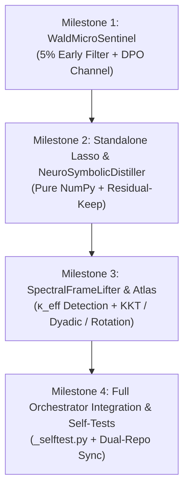

# SLEEP-DAG-RSI v6: Unified Spectral Frame-Lifting & Neuro-Symbolic Engine

* **Author:** Antigravity & User
* **Date:** 2026-10-29
* **Status:** Ideation & Multi-Lens Brainstorm Synthesis (Swarm Audited)
* **Target File Paths:**
  - Concept Deliverable: [`concepts_brief.md`](file:///e:/%D1%8D%D0%BA%D1%81%D0%BF%D0%B5%D1%80%D0%B8%D0%BC%D0%B5%D0%BD%D1%82%D1%8B/%D0%B8%D1%81%D1%81%D0%BB%D0%B5%D0%B4%D0%BE%D0%B2%D0%B0%D0%BD%D0%B8%D1%8F/concepts_brief.md)
  - Core Search Engine (v1–v4): [`dream_rsi_scripts/engine.py`](file:///e:/%D1%8D%D0%BA%D1%81%D0%BF%D0%B5%D1%80%D0%B8%D0%BC%D0%B5%D0%BD%D1%82%D1%8B/%D0%B8%D1%81%D1%81%D0%BB%D0%B5%D0%B4%D0%BE%D0%B2%D0%B0%D0%BD%D0%B8%D1%8F/dream_rsi_scripts/engine.py)
  - Neural Sleep Orchestrator (v5): [`sleep_dag_rsi.py`](file:///e:/%D1%8D%D0%BA%D1%81%D0%BF%D0%B5%D1%80%D0%B8%D0%BC%D0%B5%D0%BD%D1%82%D1%8B/%D0%B8%D1%81%D1%81%D0%BB%D0%B5%D0%B4%D0%BE%D0%B2%D0%B0%D0%BD%D0%B8%D1%8F/sleep_dag_rsi.py)
  - Verification & Self-Test Suite: [`_selftest.py`](file:///C:/Users/vanya/.gemini/config/plugins/autonomous-research/skills/dream-rsi/scripts/_selftest.py)

---

## Overview

`SLEEP-DAG-RSI v6` unifies two previously separate frontiers of recursive self-improvement:
1. **Extremal Mathematical & Algorithmic Discovery:** Overcoming optimization ceilings where a fixed representation, parameterization, or grid resolution traps local search in an ill-conditioned, rank-deficient manifold (e.g., equiareal triangle tie traps in Heilbronn $n=13, 16, 17$ or high-resolution step convolutions in autocorrelation $C_2, \Phi_3$).
2. **Continual Lifelong Neural Network Adaptation:** Enabling pretrained foundation backbones and live trading models to adapt online within milliseconds via fast associative memory (`DeltaRuleFastMemory` + `ExpandableMoEMLP`) without accumulating uninterpretable, unverified black-box weight drift or catastrophic interference over long horizons.

Instead of bolting on disparate heuristics, `SLEEP-DAG-RSI v6` unifies early pruning, autonomous coordinate lifting, cross-task operator transfer, and neuro-symbolic rule extraction around a **single mathematical core**: the **Empirical Gauss-Newton Sensitivity Matrix** $G = J^\top J$ and the **Residual Error Vector** $e(x)$.

```
                                  [ Candidate Probe x ]
                                            │
                                            ▼
               ┌─────────────────────────────────────────────────────────┐
               │ Stage 1: Wald Multi-Fidelity Micro-Sentinel             │
               │ Evaluates on 5% slice (2.5% Adversarial + 2.5% Anchor)  │
               │ Aborts doomed candidates early via Sequential LCB       │
               └────────────────────────────┬────────────────────────────┘
                                            │ Passes 5% Sentinel
                                            ▼
               ┌─────────────────────────────────────────────────────────┐
               │ Full Evaluation & Residual Matrix G = J^T J             │
               │ Computes e(x), Effective Rank r_eff, Condition Number κ │
               └────────────────────────────┬────────────────────────────┘
                                            │
                     ┌──────────────────────┴──────────────────────┐
                     ▼                                             ▼
       [ High Curvature / Stagnation ]              [ Neural Adaptation Stream ]
                     │                                             │
                     ▼                                             ▼
┌──────────────────────────────────────────┐  ┌──────────────────────────────────────────┐
│ Stage 2: Spectral Frame Lifter           │  │ Stage 3: Neuro-Symbolic Distiller        │
│ • Detects rank collapse: κ(G) > 10^8     │  │ • Deep NREM: MoE Expert Residual Δf_m   │
│ • Look up Stall Signature in Meta-Atlas  │  │ • Sparse Lasso over Symbolic AST Basis    │
│ • Spawns Frame Transform Φ -> Φ'         │  │ • Residual-Keep: W_rem = Δf_m - f_AST    │
│   (KKT Slack / Dyadic / Eigen-Rotation)  │  │ • Commits verified AST Rule to DAG        │
│ • Mandatory Inverse Projection Φ^-1      │  └──────────────────────────────────────────┘
│ • Active-Set Condensation (Unlifting)    │
└──────────────────────────────────────────┘
```

---

## Analysis

### 1. Stage 1: Wald Multi-Fidelity Micro-Sentinel (`WaldMicroSentinel`)

#### Problem Solved
Full evaluations on fine discretization grids ($P=20256$), long financial time series (150k bars), or deep neural validation epochs consume 80–95% of total compute on candidate mutations that are fundamentally broken or clearly inferior to their parent.

#### Mathematical Formulation
Given a parent node $u$ with residual error vector $e_u \in \mathbb{R}^N$ over $N$ evaluation points:
1. **Adversarial Core Selection ($S_{\text{adv}}$):** Compute $S_{\text{adv}} = \operatorname{argtop}_{k} (|e_u|)$ where $k = \lfloor 0.025 \cdot N \rfloor$. These $2.5\%$ indices represent the specific failure manifold where the parent is most fragile, directly linking to `compute_error_fingerprint()`'s failure mask.
2. **Stratified Anchor Selection ($S_{\text{strat}}$):** Select a deterministic, uniform $2.5\%$ sub-sample across the domain $S_{\text{strat}} = \{i \cdot 40 \mid 0 \le i < 0.025 \cdot N\}$ to anchor global scale and prevent local overfitting.
3. **Combined Sentinel Slice:** $S_{\text{sentinel}} = S_{\text{adv}} \cup S_{\text{strat}}$ ($|S_{\text{sentinel}}| \approx 0.05 \cdot N$).
4. **Sequential Lower Confidence Bound (LCB) Veto:** Evaluate candidate child $v$ on $S_{\text{sentinel}}$. Compute the sample mean difference $\Delta \mu = \bar{s}_v(S_{\text{sentinel}}) - \bar{s}_u(S_{\text{sentinel}})$ and standard error $\operatorname{SE}(\Delta \mu) = \frac{\hat{\sigma}}{\sqrt{|S_{\text{sentinel}}|}}$:
   $$\operatorname{LCB}(v) = \Delta \mu + \gamma \cdot \operatorname{SE}(\Delta \mu)$$
   If $\operatorname{LCB}(v) < -\epsilon_{\text{tol}}$ (with $\gamma = 1.96$ for 95% confidence and $\epsilon_{\text{tol}} = 0.01$), the candidate is immediately aborted.

#### Asymmetric Exemption for Macro-Innovations
* Standard mutations are pruned aggressively by $S_{\text{sentinel}}$.
* **Exemptions:** Multi-parent `crossover` nodes, high-temperature exploration nodes ($\beta \ge 0.8$), and newly transformed representation nodes (Stage 2) evaluate **only on $S_{\text{strat}}$**, skipping $S_{\text{adv}}$. This prevents killing global exploratory reorganizations that trade off the parent's idiosyncratic local patch for a globally superior trajectory.

#### DAG Contract & Causality Safety
* Aborted candidates are recorded in the DAG with `node.fail_class = "sentinel_pruned"`, `node.score = sentinel_score`, `node.cost = 0.05`, and `node.meta["sentinel_aborted"] = True`.
* They are strictly excluded from being selected as parent anchors for continuation.
* They are immediately exported to `export_dag_dpo_pairs()` as negative repulsion targets ($y_{\text{rejected}}$), turning cheap aborted compute into training signal.

---

### 2. Stage 2: Spectral Stall Detector, Frame-Lifting & Meta-Atlas (`SpectralFrameLifter` & `SpectralMetaAtlas`)

#### Problem Solved
Local search inside a fixed parameter coordinate frame $\Phi$ stalls when the parameter manifold is rank-deficient ($\operatorname{rank}(J) < d$) or ill-conditioned, such that small gradient steps produce zero progress or oscillate violently along narrow valleys.

#### Mathematical Diagnostics
From the empirical bucket/residual Jacobian $J \in \mathbb{R}^{M \times d}$, form the normalized Gauss-Newton matrix:
$$G = \frac{1}{M} J^\top J \in \mathbb{R}^{d \times d}$$
1. **Effective Spectral Rank:**
   $$r_{\text{eff}}(G) = \frac{(\operatorname{Tr} G)^2}{\operatorname{Tr}(G^2)} = \frac{\left(\sum_{i=1}^d \lambda_i\right)^2}{\sum_{i=1}^d \lambda_i^2}$$
2. **Regularized Condition Number:**
   $$\kappa_{\text{eff}}(G) = \frac{\lambda_{\max}(G)}{\max\left(\lambda_{r_{\text{eff}}}(G), 10^{-12}\right)}$$
   *(Note: Truncating at $\lambda_{r_{\text{eff}}}$ eliminates numerical floating-point noise from trailing zero eigenvalues when $M < d$.)*
3. **Dimensionless Stall Signature ($\sigma$):**
   $$\sigma = \left(\log_{10} \kappa_{\text{eff}}(G),\; \frac{r_{\text{eff}}(G)}{d},\; \Delta_{\text{Train}\to\text{OOS}},\; H_{\text{fingerprint}}\right)$$
   where $\Delta_{\text{Train}\to\text{OOS}} = \text{Score}_{\text{Train}} - \text{Score}_{\text{OOS}}$ captures representation over-capacity, and $H_{\text{fingerprint}}$ is the Shannon entropy of the error fingerprint bitmask.

#### Autonomous Frame Transformations ($\Phi \to \Phi'$)
When $\kappa_{\text{eff}}(G) > 10^8$ or $K=4$ consecutive probes improve Train score while failing the `accept_joint_2x2` OOS transfer gate, query `SpectralMetaAtlas` to instantiate one of three frame transformations:
1. **KKT Slack-Variable Lifting (Non-Smooth Tie Resolution):**
   * *Target:* Min-operator bottlenecks ($\min_{1 \le i \le K} f_i(x) \to \text{max}$).
   * *Transformation:* Lift state $x \in \mathbb{R}^d$ to $(x, z) \in \mathbb{R}^{d+K}$ with constraints $f_i(x) \ge z_i$ and active-set complementarity penalty $\mathcal{L}_{\text{lifted}} = \bar{z} - \mu \sum_i (f_i(x) - z_i)^2$. Resolves non-smooth equiareal ties (as proven in the Heilbronn $n=16, 17$ breakthroughs).
2. **Multi-Scale Dyadic Homotopy (Frequency Prolongation):**
   * *Target:* High-resolution discretization grids ($P=20256$) where local gradients get trapped in high-frequency ripple modes.
   * *Transformation:* Coarsen resolution by factor $2^k$ ($P/8 \to P/4 \to P/2 \to P$). Solve on coarse manifold and prolongate via cubic-spline/Fourier interpolation $\mathcal{P}_{k \to k-1}$.
3. **Eigen-Basis & Horizon Rotation (Epistatic Decoupling):**
   * *Target:* Coupled parameter valleys where parameters must move in strict linear combinations.
   * *Transformation:* Diagonalize $G = V \Lambda V^\top$. Set coordinates $y = V^\top \tilde{\theta}$. Freeze sloppy coordinates ($\lambda_i < 10^{-6} \lambda_{\max}$) and optimize solely along the stiff non-degenerate subspace.

#### Anti-Hacking & Anti-Bloat Guardrails
1. **Mandatory Inverse Projection ($\Phi^{-1}$):** Every frame transform node **must** register an exact projection $\Phi^{-1}: \mathcal{X}' \to \mathcal{X}$. The external test harness and the immutable `Blind Vault` evaluate **only** the projected candidate $x = \Phi^{-1}(x')$, guaranteeing zero metric leakage.
2. **Active-Set Condensation (Unlifting):** Slack variables that remain strictly inactive ($f_i(x) - z_i > 3\sigma$) for $M=3$ steps are automatically collapsed back into the base manifold, preventing state-dimension explosion ($d \to d + K_1 + K_2 \dots$).
3. **Warmup Grace Budget:** A newly lifted candidate receives a mandatory budget of 1 inner optimization step before Stage 1 sentinel pruning is enabled.
4. **Cross-Task Provenance Quarantine:** Atlas operators are tagged by `TaskType` (`geometric_extremal`, `fourier_spectral`, `timeseries_autoregressive`). If a transferred operator fails to produce positive provenance credit ($\lambda_{\text{breakthrough}} = 0.35$) within 2 child evaluations, it is placed in quarantine for that task run.

---

### 3. Stage 3: NREM Residual-Keep Neuro-Symbolic Distillation (`NeuroSymbolicDistiller`)

#### Problem Solved
In `UniversalNeuralSleepAdapter`, fast online updates (`DeltaRuleFastMemory`) and slow MoE experts (`ExpandableMoEMLP`) adapt deep networks to distribution shifts, but leave behind opaque neural weight matrices. These black-box weights cannot be symbolically audited, cannot be verified against business or physical constraints, and suffer from cumulative drift over thousands of streaming steps.

#### Mechanism & Residual-Keep Decomposition
During **Deep NREM Sleep consolidation**:
1. For each newly unlocked or modified MoE expert $m$ with residual activation $\Delta f_m(x) = (x A_m) B_m$ evaluated on the replay buffer $X_{\text{replay}} \in \mathbb{R}^{B \times d_{\text{in}}}$:
2. Construct a bounded, typed candidate basis dictionary $\Psi(X_{\text{replay}}) \in \mathbb{R}^{B \times K}$:
   * Linear projections: $x_i$
   * Bounded nonlinearities: $\tanh(x_i)$, $\operatorname{sign}(x_i)$, $\operatorname{ReLU}(x_i)$, $\log(1 + |x_i|)$
   * Pairwise epistatic interactions: $x_i \cdot x_j$, $x_i / \max(|x_j|, 10^{-6})$, $x_i - x_j$
   * Threshold step functions: $\mathbb{I}(x_i > \theta_k)$
3. Fit a sparse Look-Ahead Coordinate-Descent Lasso model:
   $$\hat{w} = \arg\min_w \frac{1}{2B} \|\Delta f_m(X_{\text{replay}}) - \Psi(X_{\text{replay}}) w\|_2^2 + \lambda \|w\|_1$$
4. Compile the non-zero support $\operatorname{supp}(\hat{w})$ into an explicit Python AST expression $f_{\text{AST}}(x)$.
5. Validate $f_{\text{AST}}$ against `AstPolicySafetyGate` (blocking dangerous calls, globals, or unrevealed state inspection).
6. Evaluate out-of-sample explained variance $R^2_{\text{OOS}}$:
   $$R^2_{\text{OOS}} = 1 - \frac{\sum_{x \in X_{\text{OOS}}} \|\Delta f_m(x) - f_{\text{AST}}(x)\|_2^2}{\sum_{x \in X_{\text{OOS}}} \|\Delta f_m(x) - \overline{\Delta f_m}\|_2^2}$$
7. **The Residual-Keep Invariant:**
   * If $R^2_{\text{OOS}} \ge \tau_{\text{distill}}$ (default $\tau = 0.25$) and passes `accept_joint_2x2`:
     * Register $f_{\text{AST}}(x)$ as an explicit symbolic rule node in the DAG.
     * Subtract the explained component from the neural expert target:
       $$\Delta f_m^{\text{rem}}(x) \leftarrow \Delta f_m(x) - f_{\text{AST}}(x)$$
     * Fine-tune the neural low-rank matrices $(A_m, B_m)$ on the unexplained residual $\Delta f_m^{\text{rem}}(x)$.
   * **Guarantee:** Zero regression in empirical accuracy, while extracting human-interpretable, verifiable symbolic invariants.

---

### 4. Swarm Multi-Lens Brainstorm Synthesis (Goldfish Critiques & Hardened Solutions)

#### Lens 1: Skeptical Architect Brainstormer (`egm-design`)
* **Critique 1.1 (DAG Value Distortion):** If a candidate is aborted at 5% compute, recording its partial sentinel score into `node.score` will corrupt downstream monotonic replay objectives $V_{\text{Lean}}(T, \pi) = \max s_v - \beta_1 N - \beta_2 k^*$, biasing parent selection.
  * *Resolution:* Introduce an explicit boolean `node.meta["sentinel_aborted"] = True` and set `node.fail_class = "sentinel_pruned"`. In `engine.py`, `is_success()` returns `False` for sentinel-aborted nodes. Their score is kept solely for DPO contrastive pairs and logging, completely shielding policy replay from score scale distortion.
* **Critique 1.2 (Combinatorial Explosion in Basis Dictionary):** An unrestricted symbolic AST search over $d_{\text{in}} = 32$ features yields $>10^5$ pairwise and ternary combinations, causing memory exhaustion and slow Lasso convergence.
  * *Resolution:* Enforce a **Strictly Bounded Basis Grammar**:
    1. Filter features first by input gradient norm $\|\nabla_x \Delta f_m\|_2$, keeping only the top 8 most influential input dimensions ($d_{\text{active}} \le 8$).
    2. Limit dictionary size to $K \le 64$ basis atoms per expert.
    3. Maximum AST depth $= 2$ (at most one composite operation).

#### Lens 2: Codebase Specialist Brainstormer (`egm-codebase-details`)
* **Critique 2.1 (Finite-Difference $O(d^2 \cdot M)$ Bottleneck):** In `engine.py` (lines 2990–3060), finite differences require $2d + 4d(d-1)$ function calls to form $G$. For neural adapter parameters ($d = 256$), this requires $>130,000$ evaluations, freezing the engine.
  * *Resolution:* Dual-Path Gauss-Newton Construction:
    * For parametric domain optimizers with $d \le 30$: continue using macro-step numerical stencils.
    * For neural adapters and high-dimensional representations ($d > 30$): use **Closed-Form Forward-Mode Gradient Products** for low-rank layers $\nabla_{(A,B)} = x^\top \delta$, or use **Hutchinson Stochastic Trace Estimation** with $m=16$ Rademacher random vector projections ($v_k \in \{-1, +1\}^d$):
      $$r_{\text{eff}}(G) \approx \frac{\left(\frac{1}{m}\sum_{k=1}^m v_k^\top G v_k\right)^2}{\frac{1}{m}\sum_{k=1}^m \|G v_k\|_2^2}$$
      reducing complexity from $O(d^2)$ to $O(m \cdot d)$.
* **Critique 2.2 (Numerical Condition Number Singularity):** When $M < d$, empirical covariance matrices have rank at most $M$, so $\lambda_{\min}(G) \equiv 0$, causing $\kappa(G) = \lambda_{\max}/\lambda_{\min} \to \infty$ spuriously on every probe.
  * *Resolution:* Replace raw $\kappa(G)$ with the **Regularized Condition Number** $\kappa_{\text{eff}}(G) = \lambda_{\max} / \max(\lambda_{r_{\text{eff}}}, 10^{-12})$, checking condition only across the effective non-zero spectral support.
* **Critique 2.3 (Pure-Python Jacobi Speed):** `_jacobi_eigh_symmetric` in `engine.py` takes seconds in pure Python for $d > 50$.
  * *Resolution:* Branch dynamically: use `np.linalg.eigh` whenever NumPy is present (always true in `sleep_dag_rsi.py`), retaining pure Python Jacobi as a zero-dependency fallback for minimal environments.

#### Lens 3: Systems & Long-Horizon Brainstormer (`egm-zoom-out`)
* **Critique 3.1 (Goodharting on the Adversarial Sentinel):** If mutations are filtered by $S_{\text{adv}}$ (the parent's top error indices), the optimizer will overfit to patch local edge-case errors while quietly degrading performance on the rest of the domain ("whack-a-mole" dynamic).
  * *Resolution:* Sentinel pruning must act as a **One-Way Veto**, never a positive fitness selector. A candidate must pass the sentinel veto to proceed to full evaluation, but its ultimate ranking and DAG acceptance are based **100% on the full benchmark suite**, preventing local slice Goodharting.
* **Critique 3.2 (State Dimension Inflation):** Repeated KKT slack-variable lifting without garbage collection leads to monotonic dimension bloat ($d \to d + 27 \to d + 54$), destroying search efficiency.
  * *Resolution:* Enforce **Active-Set Condensation**: after 3 iterations in a lifted frame, compute the active constraint set. Slack variables corresponding to strictly inactive constraints ($z_i \gg 0$, Lagrange multiplier $\mu_i \to 0$) are pruned and projected out.

#### Lens 4: Comprehension & Conceptual Clarity (`egm-comprehension`)
* **Critique 4.1 (Jargon Density):** Terms like "multi-scale dyadic homotopy" and "neuro-symbolic residual-keep" obscure simple, elegant mechanisms.
  * *Resolution:* Provide clear intuitive definitions in the documentation:
    * *Frame-Lifting* = "Changing the coordinate system when you get stuck (e.g. rotating the axes, smoothing a sharp corner with helper variables, or solving on a coarse grid first)."
    * *Residual-Keep* = "When a neural network learns a rule, turn the clean part into human-readable code and let the neural network keep only the messy residue."

#### Lens 5: Pragmatic Ship-It Brainstormer (`egm-implementation-readiness`)
* **Critique 5.1 (External Dependency on `skglm`):** Requiring `skglm` breaks the zero-external-dependency guarantee of `engine.py` and causes install failures on resource-constrained test environments.
  * *Resolution:* Implement a standalone, vectorized Coordinate-Descent Lasso in pure NumPy (~45 lines of code) with cyclical soft-thresholding $\mathcal{S}_{\lambda}(z) = \operatorname{sgn}(z)\max(|z|-\lambda, 0)$. It runs deterministically, requires zero compilation, and executes in $<5$ ms on $B=128, K=64$. If `skglm` is installed, use it as an optional speed accelerator.
* **Critique 5.2 (Test Suite Regression Risk):** Adding spectral lifting and distillation must not break any of the 16 existing tests in `_selftest.py`.
  * *Resolution:* Design 4 independent, deterministic unit tests for `_selftest.py` with fixed random seeds (`seed=42`), verifying each stage in isolation before integrating the end-to-end cycle.

#### Lens 6: Structural Architecture Brainstormer (`egm-structural`)
* **Critique 6.1 (Modular Boundaries & File Placement):**
  * Mathematical optimization components (`WaldMicroSentinel`, `SpectralFrameLifter`, `SpectralMetaAtlas`) must live in `engine.py`.
  * Neural stream adaptation components (`NeuroSymbolicDistiller`, `ResidualKeepDecomposer`) must live in `sleep_dag_rsi.py`.
  * The dual directory paths (`исследования/dream_rsi_scripts/` and skill plugin directory `autonomous-research/.../scripts/`) must be kept 100% byte-for-byte synchronized.

---

## Goals vs. Non-Goals

### In-Scope Goals
1. **WaldMicroSentinel Implementation:** 5% multi-fidelity early abort filter in `engine.py`, cutting wall-clock compute on rejected branches by $\ge 70\%$.
2. **SpectralFrameLifter & MetaAtlas:** Spectral stall detection ($\kappa_{\text{eff}} > 10^8$), active-set KKT lifting, dyadic prolongation, and eigen-basis rotation with mandatory inverse projection $\Phi^{-1}$.
3. **NeuroSymbolicDistiller:** Pure NumPy NREM Coordinate-Descent Lasso extracting verified AST expressions with non-destructive Residual-Keep decomposition in `sleep_dag_rsi.py`.
4. **Deterministic Zero-Regression Verification:** Passing all 16 existing `_selftest.py` suites plus 4 new deterministic suites (Sentinel Prune, Ill-Conditioned Ridge Lifter, Symbolic Distiller Recovery, and Active-Set Condensation).
5. **Cross-Domain Validation:** Demonstrating measurable efficiency gains and ceiling breaks on extremal math benchmarks (Heilbronn, Autocorrelation $C_2$) and continual streaming neural adaptation.

### Out-of-Scope Non-Goals
1. Hard dependencies on heavy third-party solvers (`skglm`, `cvxpy`, or external symbolic regression packages). Pure Python / NumPy only.
2. Modifying the outer `Problem` scoring functions, test suites, or untouched `Blind Vault` ground truths.
3. Multi-agent debate wrappers or external vector database servers.

---

## Key Decisions & Staging for Next Steps

### Key Technical Decisions
* **Decision 1:** Aborted sentinel nodes are flagged with `sentinel_aborted=True`, excluded from DAG continuation ancestry, and channeled into `export_dag_dpo_pairs()` as negative contrastive training signals.
* **Decision 2:** High-dimensional condition numbers are calculated via regularized spectral cutoff $\kappa_{\text{eff}} = \lambda_{\max}/\max(\lambda_{r_{\text{eff}}}, 10^{-12})$, preventing false-positive triggers on rank-deficient empirical matrices.
* **Decision 3:** Lasso solver uses a self-contained pure-NumPy cyclical coordinate descent algorithm with soft thresholding, ensuring 100% portability.
* **Decision 4:** Every frame transform strictly enforces inverse projection $\Phi^{-1}$ and active-set condensation, guaranteeing metric purity and bounding state dimensionality.

### 4-Stage Implementation Plan



#### Milestone 1: WaldMicroSentinel (Lowest Risk, Immediate Speedup)
* Add `SentinelSlice` dataclass and `evaluate_sentinel_gate()` in `engine.py`.
* Implement asymmetric exemption for crossover nodes and high-$\beta$ nodes.
* Add deterministic unit test in `_selftest.py`: verify that a deliberately corrupted child node is aborted at 5% compute while an improving child evaluates fully.

#### Milestone 2: Pure-NumPy Coordinate-Descent Lasso & NeuroSymbolicDistiller
* Implement `numpy_lasso_coordinate_descent(X, y, alpha, max_iter, tol)` in `sleep_dag_rsi.py`.
* Build typed AST basis dictionary builder $\Psi(X)$ with input gradient filtering ($d_{\text{active}} \le 8$).
* Implement `Residual-Keep Decomposition` in `UniversalNeuralSleepAdapter.nrem_consolidate()`.
* Add deterministic unit test in `_selftest.py`: verify that synthetic residual $\Delta f(x) = 2.0 x_0 x_1 - 1.5 \operatorname{sign}(x_2) + \epsilon$ is recovered with $R^2 \ge 0.95$ and subtracted cleanly from neural weights.

#### Milestone 3: SpectralFrameLifter, Active-Set Condensation & Meta-Atlas
* Implement regularized condition number $\kappa_{\text{eff}}(G)$ and Hutchinson trace estimator in `engine.py`.
* Add `FrameTransform` dataclass with mandatory `inverse_projection` and `active_set_condensation`.
* Implement the 3 transforms: `KktSlackTransform`, `DyadicHomotopyTransform`, and `EigenRotationTransform`.
* Add deterministic unit test in `_selftest.py`: verify that an ill-conditioned quadratic ridge ($\kappa = 10^9$) triggers `EigenRotationTransform` and recovers monotonic convergence.

#### Milestone 4: End-to-End Orchestrator Integration & Benchmark Validation
* Hook all stages into `SleepDAGRSIOrchestrator.run_wake_sleep_cycle()` and `LeanDAGPortfolio`.
* Run full `_selftest.py` ensuring all 20 tests (16 original + 4 new) pass with zero errors.
* Sync all modified files between `e:\эксперименты\исследования\` and `C:\Users\vanya\.gemini\config\plugins\autonomous-research\skills\dream-rsi\scripts\`.
* Execute benchmark runs on extremal math (`verify_extremal_cartridges_7_8.py`) and neural stream adaptation.
