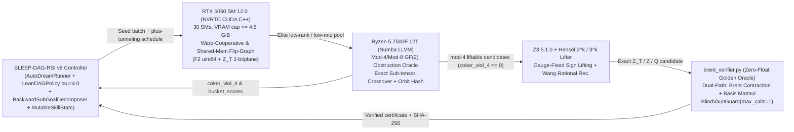

# Архитектура движка Flip-Graph + `SLEEP-DAG-RSI v8` + Hensel/SAT Lifting для Fast Matrix Multiplication (FMM)

**Статус:** Phase 0 Architecture & Tracer #1 Ready  
**Владелец:** `fmm-architect`  
**Базовый верификатор (Tracer #1):** [brent_verifier.py](file:///e:/эксперименты/исследования/fmm_discovery/src/brent_verifier.py) (`14/14 PASS`, zero floating-point)

---

## 1. Верифицированный локальный стек железа и компиляции (`VERIFIED`)

Все версии, доступность инструментов и пропускная способность проверены живыми запусками на целевой машине (`Windows-10-10.0.19045-SP0 AMD64`).

### 1.1. Аппаратные ресурсы

| Компонент | Верифицированная спецификация |
|---|---|
| **CPU** | AMD Ryzen 5 7500F 6-Core Processor (`6` физических ядер / `12` логических потоков, базовая частота `3.701 GHz`) |
| **GPU** | NVIDIA GeForce RTX 5060, Compute Capability **SM `12.0`** (Blackwell), `30` SMs, `8,151 MiB` (`7.93 GiB`) VRAM, драйвер `616.92` |
| **OS / Python** | Windows 10 x64, `Python 3.12.10` (`MSC v.1943 64 bit AMD64`) |

### 1.2. Наличие компиляторов и библиотек

| Инструмент / пакет | Статус | Версия / путь / примечание |
|---|---|---|
| `g++`, `gcc`, `clang++`, `clang` | **MISSING** | Не установлены ни в `PATH`, ни в стандартных каталогах MSYS2/MinGW/LLVM |
| `cl.exe` (MSVC), `vswhere`, `nmake`, `msbuild` | **MISSING** | Visual Studio Build Tools не установлены |
| `nvcc`, `cmake`, `mingw32-make`, `make` | **MISSING** | Системный CUDA Toolkit и CMake не установлены (`ninja.exe` есть в `Python312\Scripts`) |
| `WSL2` (`Ubuntu`) | **BLOCKED** | Установлен дистрибутив, но не запускается (`HCS_E_HYPERV_NOT_INSTALLED`) |
| `torch` + CUDA 13.0 + **NVRTC** | **FOUND** | `torch 2.11.0.dev20260112+cu130`, `torch.cuda.is_available() == True`, arch list включает `sm_120`; в `torch/lib` встроены **`nvrtc64_130_0.dll`**, `nvrtc-builtins64_130.dll`, `cudart64_13.dll`, `cublas64_13.dll` |
| `numba` + `llvmlite` | **FOUND** | `numba 0.61.2`, `llvmlite 0.44.0` (`12` CPU-потоков; `numba.cuda.is_available() == False` из-за отсутствия системного `nvvm`) |
| `z3-solver` (`z3`) | **FOUND** | `5.1.0` (`Z3 5.1.0.0`) |
| `numpy` / `scipy` / `sympy` / `networkx` | **FOUND** | `numpy 2.2.6`, `scipy 1.17.0`, `sympy 1.14.0`, `networkx 3.6.1`, `cffi 2.0.0` |
| `go` / `dotnet` | **FOUND** | `go1.25.6 windows/amd64`, `.NET 8.0.428` |
| `cython`, `python-sat` (`pysat`), `ortools`, `galois`, `triton`, `cupy` | **MISSING** | Не установлены (для Phase 2/3 при необходимости тяжелого CDCL-лифтинга `pip install python-sat` добавляет `CaDiCaL`/`Kissat`, но Phase 1–2 полностью покрываются `NVRTC + Numba + Z3 5.1.0`) |

### 1.3. Ключевое архитектурное открытие среды (живые smoke-бенчмарки)

Отсутствие локальных `g++`, `cl.exe` и `nvcc` **не является блокером** для нативной CUDA/LLVM-скорости. В ходе зондирования подтверждено три работающих без внешней установки бэкенда для bit-packed `uint64` Flip-Graph операций (`R = 23`, цикл случайных XOR-флипов):

| Бэкенд | Компиляция / загрузка | Измеренный объём | Пропускная способность (`VERIFIED`) | Роль в архитектуре |
|---|---:|---:|---:|---|
| **GPU: Direct `NVRTC` (`nvrtc64_130_0.dll` + `nvcuda.dll`, `--gpu-architecture=compute_120`)** | **`0.033 s`** (`17,188 B` PTX) | `32,768` вокеров × `50,000` шагов = `1.6384e9` флипов за `0.7199 s` | **`2.276 B flips/s`** (`2,275.9 M/s`) | **Основной высокоскоростной движок** массового параллельного Flip-Graph (RTX 5060 SM 12.0, без `nvcc` и без `cl.exe`) |
| **CPU: `Numba 0.61.2` `@njit(parallel=True)` LLVM (12 потоков)** | `1.505 s` | `12` вокеров × `5,000,000` шагов = `60e6` флипов за `0.0410 s` | **`1.465 B flips/s`** (`1,465.06 M/s`) | **CPU-сопроцессор**: GF(2) Гаусс-исключение (mod-4 оракул), канонизация, глубокий beam/DFS и fallback |
| **CPU: `Go 1.25.6` (1 поток)** | нативный `.exe` | `20e6` флипов за `0.1617 s` | `123.66 M flips/s` | Опциональный резерв (не требуется в основном тракте, т.к. `NVRTC + Numba` работают в одном Python-процессе без IPC) |

> [!IMPORTANT]
> Прямой путь `Python -> ctypes -> nvrtc64_130_0.dll -> nvcuda.dll (cuModuleLoadData + cuLaunchKernel)` поверх буферов `torch.Tensor.data_ptr()` позволяет компилировать произвольные raw CUDA C++ ядра (с `__shared__`, `__shfl_sync`, `__ballot_sync`, `__popcll`) под Blackwell SM 12.0 за **33 мс** с нулевой зависимостью от MSVC/NVCC.

---

## 2. Математическая конвенция и Tracer #1 (`brent_verifier.py`)

### 2.1. Жёсткая конвенция индексации (`C_eq_AB_row_major`)

Для схемы $\langle m, n, p : R \rangle$ над точным кольцом $\mathcal{R} \in \{\mathbb{Z}_2, \mathbb{Z}_3, \mathbb{Z}_q, \mathbb{Z}, \mathbb{Q}\}$ факторы имеют размерности:
$$U \in \mathcal{R}^{R \times (mn)}, \qquad V \in \mathcal{R}^{R \times (np)}, \qquad W \in \mathcal{R}^{R \times (mp)}.$$
Индексация строго row-major для $C = A \cdot B$:
$$\mathrm{idx}_A(i_1, i_2) = i_1 n + i_2, \qquad \mathrm{idx}_B(j_1, j_2) = j_1 p + j_2, \qquad \mathrm{idx}_C(k_1, k_2) = k_1 p + k_2,$$
$$C_{k_1, k_2} = \sum_{r=0}^{R-1} W_{r,\, k_1 p + k_2} \left(\sum_{i_1, i_2} U_{r,\, i_1 n + i_2} A_{i_1, i_2}\right)\left(\sum_{j_1, j_2} V_{r,\, j_1 p + j_2} B_{j_1, j_2}\right).$$

Эквивалентная система **уравнений Брента**:
$$\sum_{r=0}^{R-1} U_{r,\, i_1 n + i_2}\, V_{r,\, j_1 p + j_2}\, W_{r,\, k_1 p + k_2} = \delta_{i_1, k_1}\,\delta_{i_2, j_1}\,\delta_{j_2, k_2}.$$

**Защита от бага транспонирования ($C = AB$ vs $\mathrm{tr}(ABC_{\mathrm{tr}})$):**  
В литературе по Flip-Graph (Kauers–Moosbauer, каталог Лилля) часто используется циклическая форма $\mathrm{tr}(A B C_{\mathrm{tr}}) = \sum_{i,j,k} A_{ij} B_{jk} (C_{\mathrm{tr}})_{ki}$, где $C_{\mathrm{tr}} = C^T \in \mathcal{R}^{p \times m}$ и индекс третьего фактора равен $k_2 m + k_1$. Связь с нашей конвенцией:
$$W^{\mathrm{tr}}_{r,\, k_2 m + k_1} = W_{r,\, k_1 p + k_2}.$$
В `brent_verifier.py` это преобразование инкапсулировано методами `BilinearScheme.w_to_trace_convention()` и `BilinearScheme.from_trace_convention()`, проверенными на неквадратной схеме $\langle 2,2,3:11 \rangle$ (где $m \neq p$).

### 2.2. Результаты живого `--selftest` Tracer #1 (`VERIFIED`)

Команда: `python -X utf8 e:\эксперименты\исследования\fmm_discovery\src\brent_verifier.py --selftest` (и `ruff check` + `py_compile`) завершилась с кодом `0`, **`14/14 PASS`**:

- **Strassen $\langle 2,2,2:7 \rangle$ over $\mathbb{Z}$**: `valid=True`, `is_ternary=True`, `max_abs=1`, `naive_additions_total=18`, `nnz_total=36`, время dual-path проверки `0.21 ms`.
- **Laderman $\langle 3,3,3:23 \rangle$ over $\mathbb{Z}$**: `valid=True`, `is_ternary=True`, `max_abs=1`, `naive_additions_total=98`, `nnz_total=153`, `729` уравнений Брента + `81` базисная пара, `1.65 ms`.
- **Strassen over $\mathbb{Z}_2, \mathbb{Z}_3, \mathbb{Z}_4, \mathbb{Q}$ (масштабированный дробями $1/2, 1/3, 6$)**: все `PASS`, `canonical_sha256` инвариантен к перестановке слагаемых, перевороту знаков и рациональному масштабированию.
- **Неквадратные схемы $\langle 2,3,4:24 \rangle$ и $\langle 2,2,3:11 \rangle$**: `PASS` (включая проверку случайных целочисленных матриц).
- **Tamper-контроль (6 кейсов: `U/V/W` по $\mathbb{Z}$, $\mathbb{Z}_2$, $\mathbb{Z}_4$, $\mathbb{Q}$)**: изменение `1` элемента отлавливается **одновременно** Path 1 (тензорная свёртка Брента) и Path 2 (прямое умножение всех $(mn)(np)$ базисных пар $E_{i_1,i_2} E_{j_1,j_2}$).
- **Запрет float**: передача `float` / `np.floating` немедленно бросает `TypeError`.
- **Масштабирование времени dual-path проверки**: naive $\langle 3,3,3:27 \rangle$ — `2.3 ms`, $\langle 4,4,4:64 \rangle$ — `13.7 ms`, $\langle 5,5,5:125 \rangle$ — `46.2 ms`.

---

## 3. Архитектура Bit-Packed `uint64` Flip-Graph движка

Для всех размерностей с $mn, np, mp \le 64$ (т.е. включительно до $8 \times 8 \times 8$ и всех неквадратных форм вроде $\langle 4,4,5 \rangle$, $\langle 4,5,5 \rangle$, $\langle 5,5,5 \rangle$, $\langle 6,6,6 \rangle$, $\langle 4,7,7 \rangle$) каждый вектор $u_r, v_r, w_r$ целиком помещается в одно машинное слово `uint64_t`:

- **$\mathbb{F}_2$-представление**: тройка `(uint64_t u[r], uint64_t v[r], uint64_t w[r])` — `24` байта на терм (`R = 96` занимает всего `2,304` байта $\implies$ целиком в L1/Shared Memory!).
- **Тернарное $\mathbb{Z}_T = \{-1, 0, +1\}$-представление (2 bitplanes)**: каждый фактор кодируется парой `(uint64_t pos, uint64_t neg)` с инвариантом `pos & neg == 0` (`+1 = (1,0)`, `0 = (0,0)`, `-1 = (0,1)`) — `48` байт на терм (`R = 96` занимает `4,608` байт $\implies$ также полностью в Shared Memory!).

### 3.1. Точная алгебра операторов Flip-Graph ($\mathbb{F}_2$ и $\mathbb{Z}_T$)

Пусть схема задана суммой $T = \sum_{r=0}^{R-1} u_r \otimes v_r \otimes w_r$.

#### (1) `flip` ($R \to R$)
При совпадении одного фактора у пары $i \neq j$ (например, $W$-флип: $w_i = s w_j$, $s \in \{+1, -1\}$, над $\mathbb{F}_2$ просто $w_i = w_j$):
$$(s u_i) \otimes v_i \otimes w_j + u_j \otimes v_j \otimes w_j = (s u_i) \otimes (v_i - \alpha v_j) \otimes w_j + (u_j + \alpha s u_i) \otimes v_j \otimes w_j$$
для $\alpha \in \{+1, -1\}$ (в $\mathbb{F}_2$: $v_i' = v_i \oplus v_j,\; u_j' = u_j \oplus u_i$).  
Аналогично определены $U$-флипы ($u_i = s u_j$) и $V$-флипы ($v_i = s v_j$).

**Branchless-проверка и сложение в 2-bitplane $\mathbb{Z}_T$ (6 битовых инструкций на 64 координаты):**  
Для $a = (p_a, n_a)$ и $b = (p_b, n_b)$ (отрицание $-b = (n_b, p_b)$ стоит `0` инструкций):
```cpp
__device__ __forceinline__ bool ternary_add(
    uint64_t pa, uint64_t na, uint64_t pb, uint64_t nb,
    uint64_t& po, uint64_t& no
) {
    uint64_t overflow = (pa & pb) | (na & nb);   // (+1)+(+1) or (-1)+(-1)
    if (overflow != 0ULL) return false;          // violates {-1, 0, +1}
    uint64_t dp = pa ^ pb;
    uint64_t dn = na ^ nb;
    po = dp & ~dn;                               // cancels (+1)+(-1) -> 0
    no = dn & ~dp;
    return true;
}
```
Сравнение знаков: $w_i = +w_j \iff (p_{w_i} = p_{w_j}) \wedge (n_{w_i} = n_{w_j})$, а $w_i = -w_j \iff (p_{w_i} = n_{w_j}) \wedge (n_{w_i} = p_{w_j})$.

#### (2) `reduce` ($R \to R - 1$ и $R \to R - 2$)
1. **Обнуление фактора**: после флипа $u_k = 0 \vee v_k = 0 \vee w_k = 0 \implies$ удаляем терм $k$ ($R \to R-1$).
2. **Двухфакторное слияние (collision)**: если $u_i = s_u u_j$ и $v_i = s_v v_j$ (или циклически на любой паре осей), заменяем пару $(i, j)$ одним термом $(u_j, v_j, s_u s_v w_i + w_j)$. В $\mathbb{F}_2$ редукция безусловна (при $w_i = w_j$ исчезают **оба** терма: $R \to R-2$); в $\mathbb{Z}_T$ требуется `ternary_add == true`.
3. **Многотермовая линейная редукция ($k$-term collapse)**: внутри класса эквивалентности с общим фактором $S = \{r : w_r = \pm w_0\}$ при $|S| \ge 3$ линейная зависимость $u_k = \sum_{r \in S \setminus \{k\}} c_r u_r$ ($c_r \in \mathbb{F}_2$ или $\{-1, 0, 1\}$) немедленно сворачивает терм $k$ в остальные:
   $$\sum_{r \in S \setminus \{k\}} u_r \otimes (v_r + c_r v_k) \otimes w_0 \quad (R \to R-1).$$
   Над $\mathbb{F}_2$ проверка ранга подматрицы $U_S$ занимает $O(|S|)$ XOR-операций.

#### (3) `plus` ($R \to R + 1$ — туннелирование между несвязными компонентами)
Обычный граф флипов на фиксированном ранге $R$ распадается на несвязные компоненты (локальные ловушки). Оператор `plus` (Arai–Ichikawa–Hukushima 2024; Kauers–Moosbauer 2024) переводит любую несмежную пару $(i, j)$ в 3 терма **точно над любым кольцом** (для $s, \alpha \in \{+1, -1\}$):
$$u_i \otimes v_i \otimes w_i + u_j \otimes v_j \otimes w_j = \underbrace{u_i \otimes v_i \otimes (w_i - s w_j)}_{T_1} + \underbrace{(s u_i) \otimes (v_i - \alpha v_j) \otimes w_j}_{T_2} + \underbrace{(u_j + \alpha s u_i) \otimes v_j \otimes w_j}_{T_3}.$$
Проверка тождества: перекрёстные слагаемые $\mp s\, u_i \otimes v_i \otimes w_j$ и $\mp \alpha s\, u_i \otimes v_j \otimes w_j$ взаимно уничтожаются.  
В $\mathbb{F}_2$ ($s = \alpha = 1$):
$$T_1 = (u_i,\; v_i,\; w_i \oplus w_j), \qquad T_2 = (u_i,\; v_i \oplus v_j,\; w_j), \qquad T_3 = (u_i \oplus u_j,\; v_j,\; w_j).$$
Термы $(T_1, T_2)$ сразу образуют $U$-ребро, $(T_2, T_3)$ — $W$-ребро, а новый вектор $w_i \oplus w_j$ может мгновенно сработать на `reduce` с третьим термом $w_k$. С учётом 6 перестановок осей $(U,V,W)$ каждая пара $(i, j)$ даёт 6 вариантов `plus`. В $\mathbb{Z}_T$ ход допустим, если все три суммы проходят `ternary_add`.

#### (4) `split` ($R \to R + 1$ с сохранением структуры / разреженности)
Для терма $r$ и любого ненулевого вектора $x$:
$$u_r \otimes v_r \otimes w_r = x \otimes v_r \otimes w_r + (u_r - x) \otimes v_r \otimes w_r.$$
Два целевых режима:
- **Targeted-edge split**: $x = u_k$ (другой существующий терм) мгновенно создаёт $U$-ребро к терму $k$ без предварительного совпадения по $V$ или $W$.
- **Disjoint-support split (гарантированно безопасный для $\mathbb{Z}_T$)**: выбор $x$ как подмаски ненулевых битов $u_r$ (`(px & ~pu_r) == 0 && (nx & ~nu_r) == 0`) **всегда** сохраняет $\{-1,0,1\}$ и строго уменьшает вес Хэмминга `popcount`, открывая коллизии с разреженными базисными термами.

#### (5) `meta-flip` (межразмерностные переходы $\langle m, n, p \rangle \leftrightarrow \langle m, n, p \pm 1 \rangle$)
- **Down-projection (срез) $\langle m, n, p \rangle \to \langle m, n, p - 1 \rangle$**: зануление столбца $k^*$ в $B$ и $C$ одной битовой маской (`v[r] &= col_mask_B`, `w[r] &= col_mask_C`). Все термы с $v_r = 0$ или $w_r = 0$ мгновенно исчезают; выбор оптимального столбца $k^*$ (или предварительная замена базиса $B \mapsto BQ, C \mapsto CQ$ для максимизации числа обнуляемых термов) даёт сверхплотный старт для меньшей размерности.
- **Up-lifting / Sub-tensor gluing (`CROSSOVER`)**: конкатенация двух схем из архива
  $$\langle m, n, p_1 : R_1 \rangle \oplus_p \langle m, n, p_2 : R_2 \rangle \longrightarrow \langle m, n, p_1 + p_2 : R_1 + R_2 \rangle$$
  (аналогично по осям $m$ и $n$). Общее пространство $U$-факторов вызывает каскадные `flip`+`reduce` на границе блоков, давая супераддитивное падение ранга $R < R_1 + R_2$.

#### (6) Редукция орбит симметрий ($S_3$, мономиальная группа и $\mathrm{GL}$-сэндвичи)
Тензор $T_{\langle m,n,p \rangle}$ инвариантен относительно:
1. **$S_3$-перестановок размерностей**: циклического сдвига $(U, V, W_{\mathrm{tr}}) \mapsto (V, W_{\mathrm{tr}}, U)$ ($\langle m,n,p \rangle \to \langle n,p,m \rangle$) и транспонирования $(AB)^T = B^T A^T$ ($\langle m,n,p \rangle \to \langle p,n,m \rangle$).
2. **Мономиальной (знаково-перестановочной) группы $B_m \times B_n \times B_p$**: сохраняет $\mathbb{Z}_T$, `nnz_total` и распределение весов Хэмминга.
3. **Общей линейной группы $\mathrm{GL}_m \times \mathrm{GL}_n \times \mathrm{GL}_p$** (`(A, B, C) -> (P A Q^{-1}, Q B S^{-1}, P C S^{-1})`):
   - **Важное алгебраическое различие**: над $\mathbb{F}_2$ преобразование из $\mathrm{GL}(\mathbb{F}_2)$ является изоморфизмом графа флипов (сохраняет смежность $u_i = u_j$), но **радикально меняет** разреженность (`nnz`), эффективность координатных `meta-flip`-срезов и допустимость тернарного лифтинга в $\mathbb{Z}_T$! Поэтому разреженные унимодулярные замены базиса $(P, Q, S) \in \mathrm{GL}(\mathbb{Z})$ используются как оператор де-денсификации и подготовки к лифтингу.
4. **Двухуровневое хэширование для дедупликации бассейнов**:
   - *Уровень 1 ($O(R)$ в горячем цикле GPU/Numba)*: отсортированный мультисет степеней `(popcount(u_r), popcount(v_r), popcount(w_r))` + гистограмма размеров классов эквивалентности по $U, V, W$ (строго инвариантен к $S_R \times B_m \times B_n \times B_p$ и к $S_3$ при $m=n=p$).
   - *Уровень 2 (архив `DiscoveryTree`)*: точный `BilinearScheme.canonical_sha256()`.

---

## 4. Пайплайн Hensel / SAT / Z3 Lifting ($\mathbb{Z}_2 \to \mathbb{Z}_4 \to \mathbb{Z}_8 \to \dots \to \mathbb{Z}_T / \mathbb{Z} / \mathbb{Q}$)

### 4.1. Точная линейная система по модулю 2 на каждом шаге Гензеля

Пусть $(U_k, V_k, W_k)$ — точная целочисленная репрезентация валидной схемы по модулю $2^k$ ($k \ge 1$):
$$T_k := \sum_{r=0}^{R-1} U_k[r] \otimes V_k[r] \otimes W_k[r] \equiv T_{\langle m,n,p \rangle} \pmod{2^k}.$$
Тогда целочисленная невязка делится на $2^k$ нацело:
$$E_k := \frac{T_{\langle m,n,p \rangle} - T_k}{2^k} \in \mathbb{Z}^{(mn) \times (np) \times (mp)}.$$
Ищем подъём по модулю $2^{k+1}$:
$$U_{k+1} = U_k + 2^k \Delta U, \qquad V_{k+1} = V_k + 2^k \Delta V, \qquad W_{k+1} = W_k + 2^k \Delta W, \qquad \Delta U, \Delta V, \Delta W \in \{0, 1\}^{\dots}.$$
Так как для всех $k \ge 1$ выполняется $2k \ge k + 1$, **все квадратичные и кубические по $\Delta$ члены кратны $2^{2k} \equiv 0 \pmod{2^{k+1}}$ и тождественно обнуляются**. После деления на $2^k$ условие $T_{k+1} \equiv T_{\langle m,n,p \rangle} \pmod{2^{k+1}}$ сводится к **точной линейной системе над $\mathbb{F}_2$ с фиксированным якобианом $J_1$**:
$$\mathcal{J}_1(\Delta U, \Delta V, \Delta W) \equiv E_k \pmod 2,$$
где $\mathcal{J}_1$ зависит **только** от базовой $\mathbb{F}_2$-схемы $(U_1, V_1, W_1) = (U_k, V_k, W_k) \bmod 2$:
$$\mathcal{J}_1(\Delta U, \Delta V, \Delta W)_{a,b,c} = \sum_{r=0}^{R-1} \Big(\Delta U_{r,a} V_{1;r,b} W_{1;r,c} + U_{1;r,a} \Delta V_{r,b} W_{1;r,c} + U_{1;r,a} V_{1;r,b} \Delta W_{r,c}\Big) \pmod 2.$$

### 4.2. Обструкции, Mod-4 / Mod-8 оракул и калибровочная редукция (`2R` Gauge Fixing)

1. **Точный критерий обструкции $\mathbb{Z}_2 \not\to \mathbb{Z}_4$**:  
   Схема $(U_1, V_1, W_1)$ **доказуемо не поднимается** в $\mathbb{Z}_4$ (а значит и в $\mathbb{Z}$ с тем же вычетом $\bmod 2$) тогда и только тогда, когда правая часть $e_1 = E_1 \bmod 2$ не ортогональна левому ядру якобиана:
   $$\exists\,\lambda \in \ker(J_1^T) : \langle \lambda, e_1 \rangle \equiv 1 \pmod 2.$$
   Для **наведения поиска** в Flip-Graph определяем целочисленный дефект обструкции:
   $$\mathrm{coker\_viol}_4(U_1, V_1, W_1) := \#\big\{\text{несовместных строк } [0 \mid 1] \text{ после }\mathbb{F}_2\text{-исключения Гаусса для }[J_1 \mid e_1]\big\} \ge 0.$$
   - $\mathrm{coker\_viol}_4 = 0 \iff$ схема **поднимаема по модулю 4** (проходит в следующий эшелон).
   - $\mathrm{coker\_viol}_4 > 0 \implies$ оракул возвращает гладкий градиентный сигнал для `SLEEP-DAG-RSI`: из двух $\mathbb{F}_2$-схем одинакового ранга $R$ приоритет получает схема с меньшим $\mathrm{coker\_viol}_4$!

2. **Сверхбыстрый оракул тернарного лифтинга $\mathbb{Z}_2 \to \mathbb{Z}_T$ (Support-Restricted Sign Lifting)**:  
   При подъёме в $\mathbb{Z}_T = \{-1, 0, +1\}$ без добавления новых ненулевых элементов каждый $0 \mapsto 0$, а каждая $1 \mapsto (-1)^\sigma = 1 - 2\sigma \equiv 1 + 2\sigma \pmod 4$, $\sigma \in \{0, 1\}$. Поэтому $\Delta$ ограничивается **только ненулевыми позициями** (`nnz_total` переменных вместо $R(mn+np+mp)$!), а фиксация знака первого ненулевого элемента в $u_r$ и $v_r$ (калибровка $2R$ тривиальных знаковых симметрий $(-u_r, -v_r, w_r)$ и $(-u_r, v_r, -w_r)$) **без потери общности** вычитает $2R$ фиктивных степеней свободы!

   **Живая верификация оракула (измерено на локальной машине в этой сессии):**

   | Схема ($\bmod 2$, знаки стёрты) | `nnz_vars` | Активных уравнений | $\mathrm{rank}_{\mathbb{F}_2}(J_1|_{\mathrm{supp}})$ | Полная `nullity` | Калибровка `2R` | **Истинных свободных бит** | Время оракула (чистый Python) |
   |---|---:|---:|---:|---:|---:|---:|---:|
   | Strassen $\langle 2,2,2:7 \rangle$ | `36` | `20` | `19` | `17` | `14` | **`3`** ($2^3 = 8$) | **`0.07 ms`** |
   | Laderman $\langle 3,3,3:23 \rangle$ | `153` | `119` | `95` | `58` | `46` | **`12`** ($2^{12} = 4,096$) | **`0.31 ms`** |

   > [!TIP]
   > На Laderman $\langle 3,3,3:23 \rangle$ mod-4 оракул + `2R`-калибровка за **0.31 мс** сжимают пространство поиска знаков с $2^{153} \approx 1.1 \times 10^{46}$ до **$2^{12} = 4,096$** кандидатов! На Numba/GPU полный перебор 4,096 ветвей или проверка в Z3 занимают миллисекунды.

3. **Вторичная обструкция на шаге $k = 2$ ($\mathbb{Z}_4 \to \mathbb{Z}_8$) и полная цепочка лифтинга**:  
   Общее решение шага $k=1$ образует аффинное подпространство $\Delta_1(c) = \Delta_1^{(0)} + \sum_{t=1}^{d_{\mathrm{free}}} c_t h_t$. При подстановке в $T_2$ квадратичный вклад $4 Q(\Delta_1(c))$ входит в $E_2 \bmod 2$ **квадратично по $c$**. Поэтому частное решение $\Delta_1^{(0)}$ может застрять на $k=2$, тогда как другой выбор $c$ поднимается до $\mathbb{Z}_8 \to \mathbb{Z}_{16} \to \dots \to \mathbb{Z}_{2^{64}}$.

   **Четырёхэшелонный каскад лифтинга (`hensel_lifter.py`):**
   - **Эшелон L0 (< 0.5 ms, Numba GF(2))**: Support-restricted mod-4 оракул + `2R`-калибровка. Если `coker_viol_4 == 0` и `d_free <= 20` $\implies$ мгновенный точный перебор/проверка тернарного лифта $\mathbb{Z}_T$.
   - **Эшелон L1 (Z3 5.1.0, `Bool`/`Int` + подстановка базиса $\ker J_1|_{\mathrm{supp}}$)**: точный SAT/SMT-поиск тернарного $\mathbb{Z}_T$ (или ограниченного `[-2, 2]`) подъёма. *(Базовый контрольный тест в этой сессии: даже наивная Z3 `Int`-кодировка без подстановки ядра подняла Strassen $\mathbb{Z}_2 \to \mathbb{Z}_T$ за `77.65 ms`, `brent_verified=True`.)*
   - **Эшелон L2 (Общий $2$-адический Гензель $\mathbb{Z}_2 \to \mathbb{Z}_{2^{64}}$ + Rational Reconstruction)**: при отсутствии тернарного лифта снимаем ограничение на носитель, решаем $J_1 \Delta_k \equiv E_k \pmod 2$ (с перебором/Z3 на квадратичной стыковке $k=2$ и квадратичным удвоением $2^k \to 2^{2k}$ начиная с $k=2$, где линейный шаг устойчив), затем применяем алгоритм Ванга (Extended Euclidean Rational Reconstruction $\bmod 2^{64}$) для восстановления точных дробей `fractions.Fraction(p, q)` с нечётными знаменателями ($|p|,|q| < 2^{31}$) и верифицируем в `brent_verifier.py` над `"Q"`.
   - **Эшелон L3 (Трек $\mathbb{Z}_3 \to \mathbb{Z}_{3^k} \to \mathbb{Q}$ для схем со знаменателем $1/2$)**: если оптимальная схема над $\mathbb{Q}$ содержит дроби $1/2$ (например, схемы с $2$-адическим полюсом), она принципиально не имеет $\mathbb{Z}_2$-редукции, но $2^{-1} \equiv 2 \pmod 3$ существует! Параллельный трек над $\mathbb{Z}_3$ (также упакованный в 2 bitplanes `uint64` с арифметикой $\bmod 3$!) и $3$-адический Гензель закрывают этот слепой угол.

---

## 5. Производительная архитектура: NVRTC GPU (RTX 5060 SM 12.0) + Numba CPU (Ryzen 5 7500F)

Так как `nvcc` и `g++` отсутствуют, но **NVRTC (`compute_120`)** и **Numba LLVM (12 потоков)** верифицированы с пропускной способностью `2.276 B` и `1.465 B` элементарных флипов/с, архитектура разделяется строго по природе вычислений:



### 5.1. Устранение главного узкого места GPU-ядра (Register Spilling & $O(R^2)$ Pair Lookup)

В нашем первичном smoke-бенчмарке `2.276 B flips/s` массив `u[23], v[23], w[23]` в локальном стеке потока (`69 × uint64 = 138` 32-битных регистров) уже подходил к порогу register spilling, а при $R = 50\text{–}100$ локальные массивы неминуемо прольются в slow local memory. В боевом ядре Phase 1 применяются два специализированных макета памяти (бюджет VRAM жёстко ограничен $\le 4.5\text{ GiB}$ из `7.93 GiB`):

1. **Режим A — `1 Warp (32 потока) = 1 схема` (для $R \le 64$ и $R \le 128$):**
   - Каждый поток варпа хранит `2–4` терма `(u, v, w)` прямо в регистрах (`12–24` регистра на поток $\implies$ **нулевой spilling**, максимальная occupancy на 30 SM RTX 5060!).
   - Поиск всех допустимых `flip`-партнёров для выбранного терма $i$ (сравнение $w_i$ со всеми $w_j$) выполняется за **`1` такт через `__shfl_sync` + `__ballot_sync(0xFFFFFFFF, w_j == w_i)`** (параллельная проверка сразу `32` термов вместо цикла $O(R)$!).
   - Аналогично проверка `reduce` (коллизия сразу по двум осям после каждого флипа!) стоит `2` инструкции `__ballot_sync` и **никогда не пропускает редукцию $R \to R-1$**.
   - На `30` SM × `32` активных варпа/SM = `960` одновременно работающих варпов (или `4,096–16,384` time-sliced вокеров), каждый из которых делает полный поиск флипа + проверку редукции за ~20–40 тактов $\implies$ целевая реальная скорость **`0.5–2.0 B` полноценных flip+reduce шагов/с**!

2. **Режим B — `Block-Shared Tile` (`__shared__ uint64_t`, для крупных $R \in (64, 256]$, например $\langle 6,6,6 \rangle$):**
   - `1` блок (`128` потоков = `4` независимых вокера) держит схемы в Shared Memory (`4 × 256 × 24 B = 24 KiB` на блок — идеально укладывается в `48–100 KiB` Shared Memory/SM на SM 12.0!).
   - Кэш списка смежности флип-рёбер (`uint16_t edge_i[], edge_j[]`) обновляется инкрементально после каждого флипа, а при опустошении графа флипов или плато `L_stall` шагов автоматически триггерит `plus`-туннелирование прямо внутри ядра без возврата на CPU!

3. **Роль Numba 12T на CPU (асинхронно параллельно с GPU):**
   - Пока RTX 5060 прогоняет очередной `2–5`-секундный батч `plus`-туннелирования, 12 потоков Ryzen 5 7500F через `@nb.njit(parallel=True)` прогоняют **mod-4 оракул** (`coker_viol_4`) на всем элитном пуле предыдущего батча (тысячи кандидатов в секунду!), вычисляют точные `orbit_hash`, выполняют `CROSSOVER` по подтензорам и кормят `Z3 5.1.0` для всех кандидатов с `coker_viol_4 == 0`.

---

## 6. Интеграция с `dream_rsi_scripts/` (`SLEEP-DAG-RSI v8`)

Все ссылки ниже соответствуют проверенным классам и сигнатурам в [dream_rsi_scripts/](file:///e:/эксперименты/исследования/dream_rsi_scripts):

| Модуль `dream_rsi_scripts/` | Верифицированный класс / функция | Конкретная роль в FMM Discovery |
|---|---|---|
| [cartridge.py](file:///e:/эксперименты/исследования/dream_rsi_scripts/cartridge.py) | `TaskCartridge`, `BranchCandidate`, `AutoDreamRunner`, `BlindVaultGuard` | Инкапсуляция целевой размерности $\langle m,n,p \rangle$ в 5-раундовый цикл (Explore $\to$ Repair/Deepen $\to$ DAG `CROSSOVER` $\to$ Hyperparam/Schedule Polishing $\to$ Sealed Verification). `BlindVaultGuard(max_calls=1)` запускает финальную независимую проверку чемпиона через `brent_verifier.verify_scheme()`. |
| [tree.py](file:///e:/эксперименты/исследования/dream_rsi_scripts/tree.py) | `DiscoveryTree`, `Node`, `Problem`, `compute_error_fingerprint`, `compute_tukey_cap`, `compute_counterfactual_step` | Персистентный DAG всех открытых схем и траекторий `plus`-туннелирования; `Node.bucket_scores` и `Node.pass_mask` кодируют многокритериальный профиль (ранг, mod-4, mod-8, $\mathbb{Z}_T/\mathbb{Q}$, разреженность) для выбора комплементарных родителей. |
| [engine.py](file:///e:/эксперименты/исследования/dream_rsi_scripts/engine.py) | `LeanDAGWorld`, `LeanDAGPolicy(entropic_tau=4.0)`, `compute_max_tilted_objective`, `ideate_over_history`, `compute_provenance_credit`, `accept_joint_2x2` | **TTT-Discover Entropic Tilting ($\tau = 4.0$)**: концентрирует вычислительный бюджет GPU на редких пиках падения ранга $R \to R-1$ или прорывах `coker_viol_4 -> 0`, вместо усреднения по серым бассейнам. |
| [skill_state.py](file:///e:/эксперименты/исследования/dream_rsi_scripts/skill_state.py) | `BackwardSubGoalDecomposer` (`decompose`, `select_stepping_stone_seed`), `decompose_dead_buckets`, `MutableSkillState` (`carry_from`, `commit_cycle`, `compact_prompt_context`) | Когда все ветки застряли на целевом ранге $R^*$ (dead bucket $b^*$), декомпозитор автоматически синтезирует лестницу промежуточных подцелей (снижение `coker_viol_4`, минимизация `nnz_total` на ранге $R^*+1$, оптимизация подзадачи $\langle m,n,p-1 \rangle$) и переносит проверенные инварианты, dead-end орбиты и библиотеку суб-тензорных примитивов в `SKILL.state` между циклами. |
| [sentinel.py](file:///e:/эксперименты/исследования/dream_rsi_scripts/sentinel.py) | `WaldMicroSentinel(noise_regime="deterministic")` | Ранняя отсечка бесперспективных веток `plus`-туннелирования и лифтинга по бюджету микро-среза (без потери квоты GPU на тупиковые компоненты). |
| [splicer.py](file:///e:/эксперименты/исследования/dream_rsi_scripts/splicer.py) | `compute_hyper_crossover` | Многородительское планирование структурной склейки подтензоров при разбиении $\langle m,n,p \rangle$ на 2–3 блока. |

### 6.1. Отображение FMM-метрик на `Node.score` и `Node.bucket_scores`

Для каждой найденной валидной схемы (прошедшей проверку над своим кольцом) вычисляется монотонный скаляр (больше = лучше, по контракту `Problem.score`):
$$\mathrm{score}(v) = 100\,(R_{\mathrm{ref}} - R) + 15\,\mathbb{I}[\mathrm{cert}_{\mathbb{Z}/\mathbb{Q}}] + 4\,\mathbb{I}[\mathrm{obs}_4 = 0] - 0.5\,\mathrm{coker\_viol}_4 - 0.01\,\frac{\mathrm{nnz}_{\mathrm{total}}}{R} + 0.05\,\ln(1 + d_{\mathrm{flip}}),$$
где $d_{\mathrm{flip}}$ — число доступных флип-рёбер (прокси подвижности в графе флипов).

Вектор `Node.bucket_scores` $M_{v, b}$ ($> 0 \iff$ бакет решён):
- $b_0$: `R_sota + 2.5 - R` (базовый порог нетривиальности ниже naive);
- $b_1$: `R_sota + 0.5 - R` (выход на текущий мировой SOTA над $\mathbb{F}_2$);
- $b_2$: `R_sota - 0.5 - R` (**побитие SOTA по рангу**);
- $b_3$: `0.5 - coker_viol_4` (**mod-4 тернарная/гензелевская поднимаемость**);
- $b_4$: `0.5 - coker_viol_8` (**прохождение квадратичного барьера $\mathbb{Z}_4 \to \mathbb{Z}_8$**);
- $b_5$: `+1.0` если схема сертифицирована `brent_verifier.py` над $\mathbb{Z}_T / \mathbb{Z} / \mathbb{Q}$, иначе `-1.0`.

**Механика трёх ортогональных операторов под управлением `AutoDreamRunner`:**
1. **`plus`-туннелирование (Branch Exploration & Deepening)**: параметр глубины туннелирования `(k_plus, walk_len, temp_nnz, lift_bias)` полируется в Round 4 как `tunable_params` `BranchCandidate`!
2. **Структурный суб-тензорный `CROSSOVER(u, v)` (Round 3 `crossover_synthesizer`)**:
   - *Тип A (блочный)*: склейка $\langle m_1, n, p \rangle_u \oplus_m \langle m_2, n, p \rangle_v$ (или по $n, p$) + немедленный GPU-прогон `flip+reduce` для схлопывания границы.
   - *Тип B (ранг × поднимаемость)*: если родитель $u$ побеждает в $b_2$ (низкий ранг, но `coker_viol_4 > 0`), а родитель $v$ побеждает в $b_3, b_5$ (поднимаем в $\mathbb{Z}_T$), синтезатор запускает направленный `plus`-мост из $u$ с функцией энергии, штрафующей `coker_viol_4` и поощряющей сходство спектра степеней с $v$.
3. **Liftability-guided ветвление**: на каждом контрольном окне (`every 50k GPU flips`) Numba оценивает `coker_viol_4` топ-кандидатов, а `LeanDAGPolicy(entropic_tau=4.0)` перераспределяет число GPU-вокеров пропорционально $w_v \propto \exp(\tau \hat{s}_v)$!

---

## 7. Дорожная карта Phase 1–3, Tracer-бенчмарки, Go/No-Go и пороги Стоп-крана

### Phase 1: Ядро Flip-Graph (`NVRTC SM 12.0` + `Numba 12T`) и каскад лифтинга (`hensel_lifter.py`)
- **Артефакты**:
  - `fmm_discovery/src/brent_verifier.py` (**Tracer #1 — DONE, 14/14 PASS**).
  - `fmm_discovery/src/flip_graph_gpu.py` (**Tracer #2**): warp-cooperative `NVRTC compute_120` ядра для $\mathbb{F}_2$ и 2-bitplane $\mathbb{Z}_T$ (`flip`, `reduce`, `plus`, `split`, `meta-flip`) + Numba CPU fallback.
  - `fmm_discovery/src/hensel_lifter.py` (**Tracer #3**): Numba GF(2) mod-4 оракул + `2R`-калибровка + Z3 5.1.0 + $2$-адический/$3$-адический Гензель + рациональная реконструкция Ванга.
- **Обязательные cold-start Tracer-бенчмарки (нулевое использование внешних таблиц/схем!)**:
  1. $\langle 2,2,2:8 \rangle \to 7$ над $\mathbb{F}_2$ и $\mathbb{Z}_T$ за `< 0.1 s`.
  2. $\langle 3,3,3:27 \rangle \to 23$ над $\mathbb{F}_2$ и прямое $\mathbb{Z}_T$ за `< 5 s`, плюс автоматический лифт беззнаковой $\mathbb{F}_2$-схемы $\langle 3,3,3:23 \rangle \to \mathbb{Z}_T$ за `< 2 s` с `100%` валидацией в `brent_verifier.py`.
  3. $\langle 4,4,4:64 \rangle \to \le 48$ над $\mathbb{F}_2$ за `< 60 s` из schoolbook-старта.
- **Go/No-Go Gate 1**:
  - Реальная пропускная способность GPU (включая поиск пар и проверку `reduce`) $\ge 500\text{ M steps/s}$, пиковая VRAM $\le 4.5\text{ GiB}$.
  - Все 3 cold-start бенчмарка воспроизводимо проходят `brent_verifier.verify_scheme()`.
- **Порог Стоп-крана 1**: Если после 2 итераций настройки warp/shared макета GPU-ядро даёт `< 200 M steps/s` или ловит ошибку NVRTC/PTX — остановить оптимизацию ядра, зафиксировать причину в журнале и переключить основной цикл на гибрид `Numba 12T` (`1.465 B` raw XOR/s) + GPU-батчевую оценку.

### Phase 2: Интеграция `SLEEP-DAG-RSI v8` (`fmm_cartridge.py`) и боевая кампания по SOTA-целям
- **Артефакты**: `fmm_discovery/src/fmm_cartridge.py`, `fmm_discovery/src/run_fmm_campaign.py`, персистентные деревья `DiscoveryTree` и `SKILL.state`.
- **Стратегия атаки (синхронизируется с `sota_targets.json` от `@fmm-sota`)**:
  - **Трек A ($\mathbb{F}_2$ Rank Frontier)**: межразмерностный каскад `meta-flip` ($\pm 1$) + блочный `CROSSOVER` + `plus`-туннелирование с `LeanDAGPolicy(entropic_tau=4.0)` по приоритетным целям до $mn,np,mp \le 36$ (и далее до $64$).
  - **Трек B (Закрытие разрыва $R_{\mathbb{F}_2} < R_{\mathbb{Z}/\mathbb{Q}}$)**: массовый сбор *разнообразных* $\mathbb{F}_2$-схем на границе $R_{\mathbb{F}_2}$ (дедупликация по orbit-хэшу) с отбором по `coker_viol_4 == 0` + прямой 2-bitplane $\mathbb{Z}_T$ Flip-Graph + $3$-адический Гензель.
- **Go/No-Go Gate 2**: Воспроизведение текущих SOTA-рангов минимум на `3` нетривиальных целевых размерностях из `sota_targets.json` И получение хотя бы одного нового улучшения (либо снижение $R_{\mathbb{F}_2}$, либо новый подъём в $\mathbb{Z}_T/\mathbb{Z}/\mathbb{Q}$, либо строгое улучшение аддитивной сложности на SOTA-ранге), подтверждённого `brent_verifier.py`.
- **Порог Стоп-крана 2**: Если `2` последовательных 20-минутных цикла `SLEEP-DAG-RSI` на одной размерности дают `0` улучшений ранга и `0` снижения `min coker_viol_4` — вызвать `BackwardSubGoalDecomposer`, переключить вектор атаки (переход с $\mathbb{F}_2$-лифтинга на прямой $\mathbb{Z}_T$ Flip-Graph или $\mathbb{Z}_3$-трек) либо сменить целевую размерность по приоритету `sota_targets.json`.

### Phase 3: Полировка, снижение аддитивной сложности и сертификация
- **Артефакты**: `fmm_discovery/certificates/<m>_<n>_<p>_R<R>_<ring>/` — самодостаточный пакет (`scheme.json`, `scheme.lrp`, `scheme.triplets`, отчёт `brent_verifier.py --verify --json`, независимый 0-dep воспроизводящий скрипт).
- **Оптимизации**: унимодулярное разреживание базиса $(P, Q, S) \in \mathrm{GL}(\mathbb{Z})$ и `nnz`-понижающие флипы на фиксированном рекордном ранге $R^*$, затем финальный `BlindVaultGuard` аудит через `brent_verifier.py` без единого числа с плавающей точкой.
